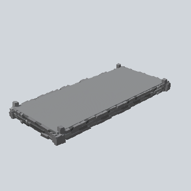

# EA03_Town_Hut_Foundation_02b_PRE

Generated by `tools/assets/gen_prefab_tables.py`: edit only below the Notes heading.

| Field | Value |
| --- | --- |
| Pack | EmaceArt-SlavicWorldFree |
| Path | `Prefabs/Compound/Foundation/EA03_Town_Hut_Foundation_02b_PRE.prefab` |
| GUID | `e6ae1b2523142a94797ab44e46647cdb` |
| Subgroup | Foundation |
| Size (m) | 20.1 |
| Collider | Box |
| LODs | 3 |
| Meshes | `EA03_Village_Hut_Foundation_02b.fbx` |
| Materials | `EA03_LPNP-Slavika_Colorsheet_v1.mat` |
| Nested prefabs | none |
| In demo scene | 0 |
| Bounds W x H x D (m) | 20.10 x 1.74 x 9.37 |
| Footprint (m) | 20.1 x 9.4 |
| Pivot | bottom at y = -0.00; center offset x 0.00, z -0.12 |
| Triangles / vertices (LOD0) | 1,858 / 3,956 |
| Average color | `#7B7C7E` |
| Dominant colors | `#8C8E90` 74%, `#474848` 19%, `#666768` 3% |

Colors are read from the rendered preview, so they include lighting. Bounds cover LOD0 renderers.

## Notes

TODO: hand-written usage notes.
