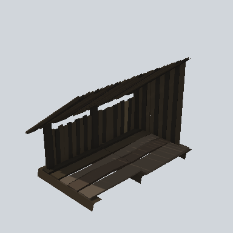
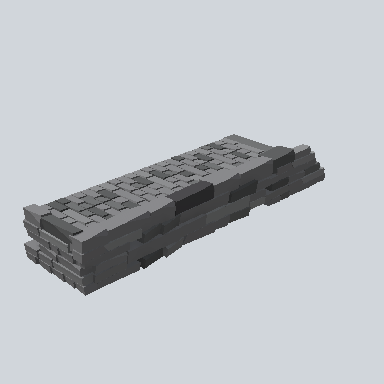
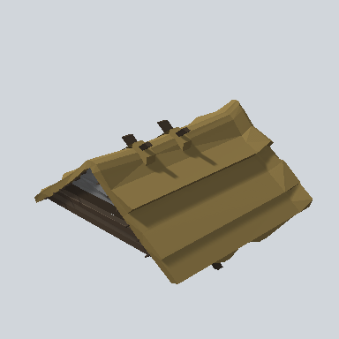
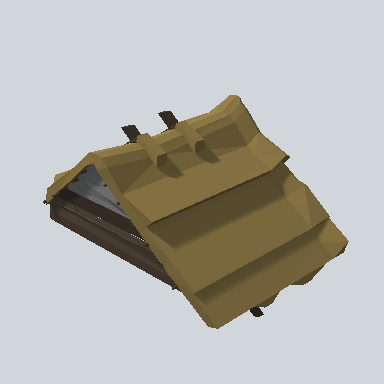
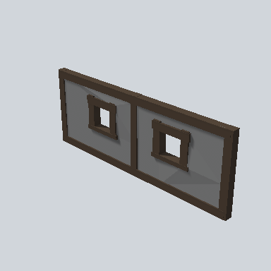

# Compound

**Prefabs: 24**

Modular hut parts: foundation, walls, roofs, porch, balcony. Every prefab has its own card; see [Prefabs](#prefabs).

| Subgroup | Count | Size (m) | Collider |
| --- | --- | --- | --- |
| `Foundation` | 1 | 20.1 | Box |
| `Walls` | 8 | 5.3 - 8.9 | 4 Box, 4 Mesh |
| `Walls_Painted` | 3 | 8.6 - 20.0 | 2 Mesh, 1 Box |
| `Roofs` | 10 | 8.5 - 20.0 | Mesh |
| `Porch` | 1 | 6.4 | Mesh |
| `Balcony` | 1 | 4.7 | Mesh |

None of these is used in the demo scene as parts; it uses finished or
single-piece buildings from `Village` and `Town`.

## Using it in a map

- Parts snap together to make a hut. They are for building variety, not for
  filling a region. A single 20 m foundation implies huts of roughly that size.
- For a first pass, use the finished buildings in `Village` and `Town` and
  leave modular assembly for later.

## Gaps

- `TODO`: the snapping rules (pivot and connection points) are not documented.
  Assemble one hut in the Editor and record the offsets.

## Prefabs

<!-- PREFAB-INDEX:START (generated) -->

**24 prefabs**, one card each.

| Preview | Subgroup | Prefab | W x H x D (m) | Main color | In scene |
| --- | --- | --- | --- | --- | --- |
|  | Balcony | [EA03_Village_Balcony_R_01a_PRE](Balcony/EA03_Village_Balcony_R_01a_PRE.md) | 4.7 x 3.4 x 2.7 | `#191714` | - |
|  | Foundation | [EA03_Town_Hut_Foundation_02b_PRE](Foundation/EA03_Town_Hut_Foundation_02b_PRE.md) | 20.1 x 1.7 x 9.4 | `#8C8E90` | - |
|  | Porch | [EA03_Village_HouseModule_Porch_R_03b_PRE](Porch/EA03_Village_HouseModule_Porch_R_03b_PRE.md) | 6.3 x 1.0 x 1.8 | `#474748` | - |
|  | Roofs | [EA03_Town_Ill_Roof_01a_PRE](Roofs/EA03_Town_Ill_Roof_01a_PRE.md) | 9.3 x 4.8 x 9.9 | `#30251A` | - |
|  | Roofs | [EA03_Town_Ill_Roof_01b_PRE](Roofs/EA03_Town_Ill_Roof_01b_PRE.md) | 12.4 x 4.9 x 9.9 | `#30251A` | - |
|  | Roofs | [EA03_Village_Hut_Ceiling_01e_PRE](Roofs/EA03_Village_Hut_Ceiling_01e_PRE.md) | 19.3 x 0.2 x 7.6 | `#2B2319` | - |
|  | Roofs | [EA03_Village_Hut_Roof_01c_PRE](Roofs/EA03_Village_Hut_Roof_01c_PRE.md) | 20.0 x 5.1 x 11.3 | `#77663C` | - |
|  | Roofs | [EA03_Village_Hut_Roof_Cut_01a_PRE](Roofs/EA03_Village_Hut_Roof_Cut_01a_PRE.md) | 16.5 x 5.1 x 11.3 | `#75643B` | - |
|  | Roofs | [EA03_Village_Hut_Roof_Cut_01b_PRE](Roofs/EA03_Village_Hut_Roof_Cut_01b_PRE.md) | 10.6 x 5.2 x 11.4 | `#76643B` | - |
|  | Roofs | [EA03_Village_Hut_Roof_Cut_01c_PRE](Roofs/EA03_Village_Hut_Roof_Cut_01c_PRE.md) | 10.5 x 5.2 x 11.4 | `#76643B` | - |
|  | Roofs | [EA03_Village_Hut_Roof_Cut_01d_PRE](Roofs/EA03_Village_Hut_Roof_Cut_01d_PRE.md) | 7.0 x 5.2 x 9.1 | `#76643B` | - |
|  | Roofs | [EA03_Village_Hut_Roof_Cut_02a_PRE](Roofs/EA03_Village_Hut_Roof_Cut_02a_PRE.md) | 8.5 x 5.4 x 6.3 | `#74633A` | - |
|  | Roofs | [EA03_Village_Hut_Roof_Half_01a_PRE](Roofs/EA03_Village_Hut_Roof_Half_01a_PRE.md) | 9.2 x 5.5 x 10.1 | `#74633A` | - |
|  | Walls | [EA03_Town_Hut_Wall_Front_04b_PRE](Walls/EA03_Town_Hut_Wall_Front_04b_PRE.md) | 0.4 x 3.0 x 8.0 | `#676768` | - |
|  | Walls | [EA03_Town_Hut_Wall_Front_04e_PRE](Walls/EA03_Town_Hut_Wall_Front_04e_PRE.md) | 0.4 x 3.0 x 7.9 | `#3C3128` | - |
|  | Walls | [EA03_Town_Hut_Wall_Front_04e_PRE 1](Walls/EA03_Town_Hut_Wall_Front_04e_PRE%201.md) | 0.4 x 3.0 x 7.9 | `#3C3128` | - |
|  | Walls | [EA03_Town_Hut_Wall_Front_04h_PRE](Walls/EA03_Town_Hut_Wall_Front_04h_PRE.md) | 0.3 x 3.0 x 7.9 | `#676768` | - |
|  | Walls | [EA03_Village_Hut_Wall_Front_02d_PRE](Walls/EA03_Village_Hut_Wall_Front_02d_PRE.md) | 0.7 x 3.1 x 8.7 | `#342D23` | - |
|  | Walls | [EA03_Village_Hut_Wall_Front_02i_PRE](Walls/EA03_Village_Hut_Wall_Front_02i_PRE.md) | 0.5 x 3.1 x 5.3 | `#28231C` | - |
|  | Walls | [EA03_Village_Hut_Wall_Front_03f_PRE](Walls/EA03_Village_Hut_Wall_Front_03f_PRE.md) | 1.7 x 3.1 x 8.8 | `#241C15` | - |
|  | Walls | [EA03_Village_Hut_Wall_Front_04f_PRE](Walls/EA03_Village_Hut_Wall_Front_04f_PRE.md) | 0.4 x 3.0 x 7.9 | `#3C3128` | - |
|  | Walls_Painted | [EA03_Town_Hut_Wall_Painted_Front_02a_PRE](Walls_Painted/EA03_Town_Hut_Wall_Painted_Front_02a_PRE.md) | 0.6 x 3.1 x 8.6 | `#3B2E24` | - |
|  | Walls_Painted | [EA03_Town_Hut_Wall_Painted_Side_02c_PRE](Walls_Painted/EA03_Town_Hut_Wall_Painted_Side_02c_PRE.md) | 20.0 x 3.1 x 0.5 | `#2C221C` | - |
|  | Walls_Painted | [EA03_Town_Hut_Wall_Painted_Side_02e_PRE](Walls_Painted/EA03_Town_Hut_Wall_Painted_Side_02e_PRE.md) | 20.0 x 3.1 x 0.8 | `#1B1916` | - |

<!-- PREFAB-INDEX:END -->
