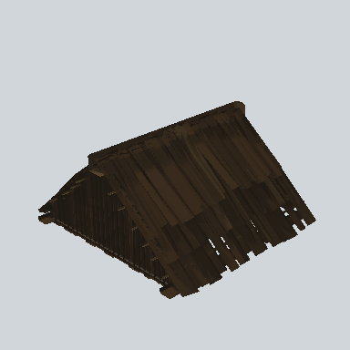

# EA03_Town_Ill_Roof_01a_PRE

Generated by `tools/assets/gen_prefab_tables.py`: edit only below the Notes heading.

| Field | Value |
| --- | --- |
| Pack | EmaceArt-SlavicWorldFree |
| Path | `Prefabs/Compound/Roofs/EA03_Town_Ill_Roof_01a_PRE.prefab` |
| GUID | `6a658c6e83d0941459dd15ac7fddc99e` |
| Subgroup | Roofs |
| Size (m) | 9.9 |
| Collider | Mesh |
| LODs | 3 |
| Meshes | `EA03_Town_Ill_Roof_01a.fbx` |
| Materials | `EA03_LPNP-Slavika_Colorsheet_v1.mat` |
| Nested prefabs | none |
| In demo scene | 0 |
| Bounds W x H x D (m) | 9.29 x 4.79 x 9.87 |
| Footprint (m) | 9.3 x 9.9 |
| Pivot | bottom at y = -0.24; center offset x -0.03, z -0.11 |
| Triangles / vertices (LOD0) | 3,236 / 5,950 |
| Average color | `#2B2218` |
| Dominant colors | `#30251A` 60%, `#231C15` 28%, `#1E1913` 9% |

Colors are read from the rendered preview, so they include lighting. Bounds cover LOD0 renderers.

## Notes

TODO: hand-written usage notes.
