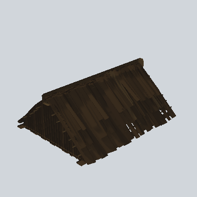

# EA03_Town_Ill_Roof_01b_PRE

Generated by `tools/assets/gen_prefab_tables.py`: edit only below the Notes heading.

| Field | Value |
| --- | --- |
| Pack | EmaceArt-SlavicWorldFree |
| Path | `Prefabs/Compound/Roofs/EA03_Town_Ill_Roof_01b_PRE.prefab` |
| GUID | `8abcc72b495ecc94697e2373b679d652` |
| Subgroup | Roofs |
| Size (m) | 12.5 |
| Collider | Mesh |
| LODs | 3 |
| Meshes | `EA03_Town_Ill_Roof_01b.fbx` |
| Materials | `EA03_LPNP-Slavika_Colorsheet_v1.mat` |
| Nested prefabs | none |
| In demo scene | 0 |
| Bounds W x H x D (m) | 12.43 x 4.88 x 9.89 |
| Footprint (m) | 12.4 x 9.9 |
| Pivot | bottom at y = 0.16; center offset x -0.66, z 0.03 |
| Triangles / vertices (LOD0) | 3,510 / 6,454 |
| Average color | `#2B2218` |
| Dominant colors | `#30251A` 63%, `#231C15` 29%, `#1E1913` 5% |

Colors are read from the rendered preview, so they include lighting. Bounds cover LOD0 renderers.

## Notes

TODO: hand-written usage notes.
