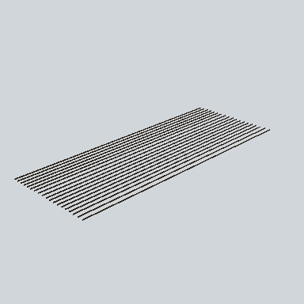

# EA03_Village_Hut_Ceiling_01e_PRE

Generated by `tools/assets/gen_prefab_tables.py`: edit only below the Notes heading.

| Field | Value |
| --- | --- |
| Pack | EmaceArt-SlavicWorldFree |
| Path | `Prefabs/Compound/Roofs/EA03_Village_Hut_Ceiling_01e_PRE.prefab` |
| GUID | `6cc9013353b72b74ea03e7c9166454a4` |
| Subgroup | Roofs |
| Size (m) | 19.3 |
| Collider | Mesh |
| LODs | 3 |
| Meshes | `EA03_Village_Hut_Ceiling_01e.fbx` |
| Materials | `EA03_LPNP-Slavika_Colorsheet_v1.mat` |
| Nested prefabs | none |
| In demo scene | 0 |
| Bounds W x H x D (m) | 19.28 x 0.20 x 7.63 |
| Footprint (m) | 19.3 x 7.6 |
| Pivot | bottom at y = -0.12; center offset x -0.00, z 0.14 |
| Triangles / vertices (LOD0) | 185 / 359 |
| Average color | `#2B2319` |
| Dominant colors | `#2B2319` 100% |

Colors are read from the rendered preview, so they include lighting. Bounds cover LOD0 renderers.

## Notes

TODO: hand-written usage notes.
