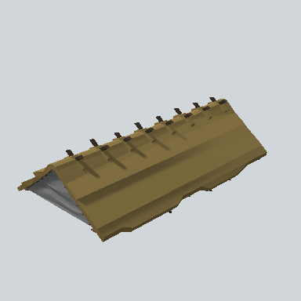

# EA03_Village_Hut_Roof_01c_PRE

Generated by `tools/assets/gen_prefab_tables.py`: edit only below the Notes heading.

| Field | Value |
| --- | --- |
| Pack | EmaceArt-SlavicWorldFree |
| Path | `Prefabs/Compound/Roofs/EA03_Village_Hut_Roof_01c_PRE.prefab` |
| GUID | `db260369185c7b54b9e9494478604f56` |
| Subgroup | Roofs |
| Size (m) | 20.0 |
| Collider | Mesh |
| LODs | 3 |
| Meshes | `EA03_Village_Hut_Roof_01c.fbx` |
| Materials | `EA03_LPNP-Slavika_Colorsheet_v1.mat` |
| Nested prefabs | none |
| In demo scene | 0 |
| Bounds W x H x D (m) | 20.02 x 5.05 x 11.30 |
| Footprint (m) | 20.0 x 11.3 |
| Pivot | bottom at y = -0.00; center offset x 0.98, z -0.03 |
| Triangles / vertices (LOD0) | 1,025 / 2,032 |
| Average color | `#6D5E3B` |
| Dominant colors | `#77663C` 34%, `#685935` 25%, `#7E6B40` 14% |

Colors are read from the rendered preview, so they include lighting. Bounds cover LOD0 renderers.

## Notes

TODO: hand-written usage notes.
