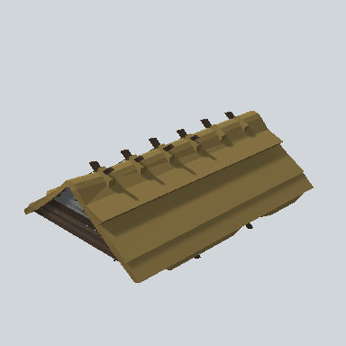

# EA03_Village_Hut_Roof_Cut_01a_PRE

Generated by `tools/assets/gen_prefab_tables.py`: edit only below the Notes heading.

| Field | Value |
| --- | --- |
| Pack | EmaceArt-SlavicWorldFree |
| Path | `Prefabs/Compound/Roofs/EA03_Village_Hut_Roof_Cut_01a_PRE.prefab` |
| GUID | `d3fc18ac09f3a724c85acef1602515dd` |
| Subgroup | Roofs |
| Size (m) | 16.5 |
| Collider | Mesh |
| LODs | 3 |
| Meshes | `EA03_Village_Hut_Roof_Cut_01a.fbx` |
| Materials | `EA03_LPNP-Slavika_Colorsheet_v1.mat` |
| Nested prefabs | none |
| In demo scene | 0 |
| Bounds W x H x D (m) | 16.53 x 5.05 x 11.30 |
| Footprint (m) | 16.5 x 11.3 |
| Pivot | bottom at y = 0.00; center offset x -2.73, z 0.03 |
| Triangles / vertices (LOD0) | 904 / 1,781 |
| Average color | `#695A37` |
| Dominant colors | `#75643B` 32%, `#574B2D` 21%, `#836F42` 17% |

Colors are read from the rendered preview, so they include lighting. Bounds cover LOD0 renderers.

## Notes

TODO: hand-written usage notes.
