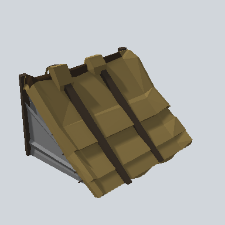

# EA03_Village_Hut_Roof_Cut_02a_PRE

Generated by `tools/assets/gen_prefab_tables.py`: edit only below the Notes heading.

| Field | Value |
| --- | --- |
| Pack | EmaceArt-SlavicWorldFree |
| Path | `Prefabs/Compound/Roofs/EA03_Village_Hut_Roof_Cut_02a_PRE.prefab` |
| GUID | `59676b0b4dd0ee24fa7248d750bdc5ef` |
| Subgroup | Roofs |
| Size (m) | 8.5 |
| Collider | Mesh |
| LODs | 3 |
| Meshes | `EA03_Village_Hut_Roof_Cut_02a.fbx` |
| Materials | `EA03_LPNP-Slavika_Colorsheet_v1.mat` |
| Nested prefabs | none |
| In demo scene | 0 |
| Bounds W x H x D (m) | 8.50 x 5.44 x 6.29 |
| Footprint (m) | 8.5 x 6.3 |
| Pivot | bottom at y = -0.54; center offset x -0.22, z 2.73 |
| Triangles / vertices (LOD0) | 793 / 1,561 |
| Average color | `#5F5236` |
| Dominant colors | `#74633A` 30%, `#564A2D` 22%, `#695935` 18% |

Colors are read from the rendered preview, so they include lighting. Bounds cover LOD0 renderers.

## Notes

TODO: hand-written usage notes.
