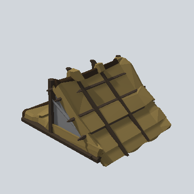

# EA03_Village_Hut_Roof_Half_01a_PRE

Generated by `tools/assets/gen_prefab_tables.py`: edit only below the Notes heading.

| Field | Value |
| --- | --- |
| Pack | EmaceArt-SlavicWorldFree |
| Path | `Prefabs/Compound/Roofs/EA03_Village_Hut_Roof_Half_01a_PRE.prefab` |
| GUID | `cccee14c4e102864795ee437bc2c7a32` |
| Subgroup | Roofs |
| Size (m) | 10.1 |
| Collider | Mesh |
| LODs | 3 |
| Meshes | `EA03_Village_Hut_Roof_Half_01a.fbx` |
| Materials | `EA03_LPNP-Slavika_Colorsheet_v1.mat` |
| Nested prefabs | none |
| In demo scene | 0 |
| Bounds W x H x D (m) | 9.17 x 5.50 x 10.15 |
| Footprint (m) | 9.2 x 10.1 |
| Pivot | bottom at y = -0.54; center offset x -0.30, z 0.80 |
| Triangles / vertices (LOD0) | 1,181 / 2,436 |
| Average color | `#5D5033` |
| Dominant colors | `#74633A` 29%, `#584B2D` 21%, `#695A35` 16% |

Colors are read from the rendered preview, so they include lighting. Bounds cover LOD0 renderers.

## Notes

TODO: hand-written usage notes.
