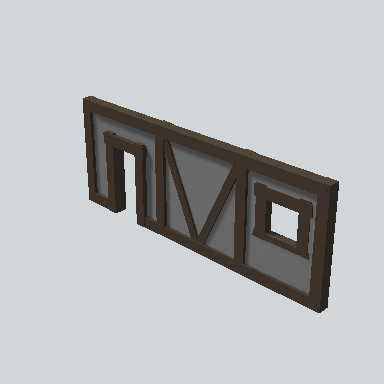

# EA03_Town_Hut_Wall_Front_04e_PRE

Generated by `tools/assets/gen_prefab_tables.py`: edit only below the Notes heading.

| Field | Value |
| --- | --- |
| Pack | EmaceArt-SlavicWorldFree |
| Path | `Prefabs/Compound/Walls/EA03_Town_Hut_Wall_Front_04e_PRE.prefab` |
| GUID | `80b2778c4fb21f945b01de2cc7f33850` |
| Subgroup | Walls |
| Size (m) | 7.9 |
| Collider | Box |
| LODs | 3 |
| Meshes | `EA03_Village_Hut_Wall_Front_04e.fbx` |
| Materials | `EA03_LPNP-Slavika_Colorsheet_v1.mat` |
| Nested prefabs | none |
| In demo scene | 0 |
| Bounds W x H x D (m) | 0.40 x 2.98 x 7.93 |
| Footprint (m) | 0.4 x 7.9 |
| Pivot | bottom at y = -0.00; center offset x 0.00, z 0.00 |
| Triangles / vertices (LOD0) | 212 / 393 |
| Average color | `#48413C` |
| Dominant colors | `#3C3128` 45%, `#666667` 25%, `#4C4C4D` 11% |

Colors are read from the rendered preview, so they include lighting. Bounds cover LOD0 renderers.

## Notes

TODO: hand-written usage notes.
