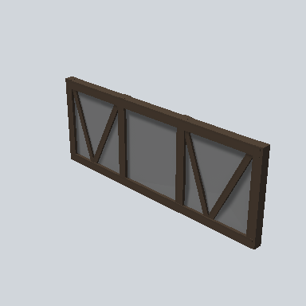

# EA03_Town_Hut_Wall_Front_04h_PRE

Generated by `tools/assets/gen_prefab_tables.py`: edit only below the Notes heading.

| Field | Value |
| --- | --- |
| Pack | EmaceArt-SlavicWorldFree |
| Path | `Prefabs/Compound/Walls/EA03_Town_Hut_Wall_Front_04h_PRE.prefab` |
| GUID | `1899adc2d5fc5e54f8b05c94d0c36f17` |
| Subgroup | Walls |
| Size (m) | 7.9 |
| Collider | Mesh |
| LODs | 3 |
| Meshes | `EA03_Village_Hut_Wall_Front_04h.fbx` |
| Materials | `EA03_LPNP-Slavika_Colorsheet_v1.mat` |
| Nested prefabs | none |
| In demo scene | 0 |
| Bounds W x H x D (m) | 0.33 x 2.98 x 7.93 |
| Footprint (m) | 0.3 x 7.9 |
| Pivot | bottom at y = -0.00; center offset x -0.01, z 0.00 |
| Triangles / vertices (LOD0) | 115 / 223 |
| Average color | `#4E4945` |
| Dominant colors | `#676768` 38%, `#3C3128` 36%, `#4B4C4D` 11% |

Colors are read from the rendered preview, so they include lighting. Bounds cover LOD0 renderers.

## Notes

TODO: hand-written usage notes.
