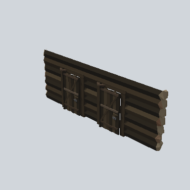

# EA03_Village_Hut_Wall_Front_02d_PRE

Generated by `tools/assets/gen_prefab_tables.py`: edit only below the Notes heading.

| Field | Value |
| --- | --- |
| Pack | EmaceArt-SlavicWorldFree |
| Path | `Prefabs/Compound/Walls/EA03_Village_Hut_Wall_Front_02d_PRE.prefab` |
| GUID | `41b2c1261ee15604e83b7b9709a0b208` |
| Subgroup | Walls |
| Size (m) | 8.7 |
| Collider | Box |
| LODs | none |
| Meshes | `EA03_Village_Hut_Wall_Front_02d.fbx` |
| Materials | `EA03_LPNP-Slavika_Colorsheet_v1.mat` |
| Nested prefabs | `EA03_Prop_House_Door_01b_PRE` |
| In demo scene | 0 |
| Bounds W x H x D (m) | 0.73 x 3.13 x 8.65 |
| Footprint (m) | 0.7 x 8.7 |
| Pivot | bottom at y = 0.00; center offset x 0.10, z 0.00 |
| Triangles / vertices (LOD0) | 1,669 / 3,124 |
| Average color | `#2D2820` |
| Dominant colors | `#342D23` 29%, `#2A241D` 28%, `#1A1815` 21% |

Colors are read from the rendered preview, so they include lighting. Bounds cover LOD0 renderers.

## Notes

TODO: hand-written usage notes.
