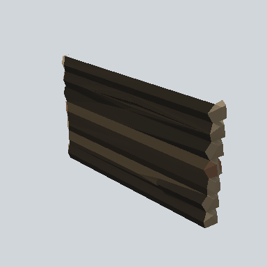

# EA03_Village_Hut_Wall_Front_02i_PRE

Generated by `tools/assets/gen_prefab_tables.py`: edit only below the Notes heading.

| Field | Value |
| --- | --- |
| Pack | EmaceArt-SlavicWorldFree |
| Path | `Prefabs/Compound/Walls/EA03_Village_Hut_Wall_Front_02i_PRE.prefab` |
| GUID | `8beab32d0b0a3f04786a91a7d19292b3` |
| Subgroup | Walls |
| Size (m) | 5.3 |
| Collider | Mesh |
| LODs | 3 |
| Meshes | `EA03_Village_Hut_Wall_Front_02i.fbx` |
| Materials | `EA03_LPNP-Slavika_Colorsheet_v1.mat` |
| Nested prefabs | none |
| In demo scene | 0 |
| Bounds W x H x D (m) | 0.55 x 3.09 x 5.31 |
| Footprint (m) | 0.5 x 5.3 |
| Pivot | bottom at y = 0.00; center offset x 0.00, z -0.03 |
| Triangles / vertices (LOD0) | 231 / 509 |
| Average color | `#2E2820` |
| Dominant colors | `#28231C` 52%, `#1A1815` 21%, `#43392B` 15% |

Colors are read from the rendered preview, so they include lighting. Bounds cover LOD0 renderers.

## Notes

TODO: hand-written usage notes.
