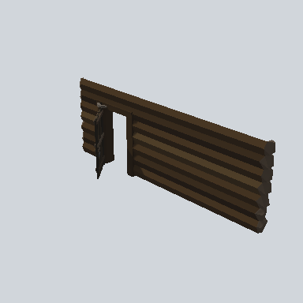

# EA03_Village_Hut_Wall_Front_03f_PRE

Generated by `tools/assets/gen_prefab_tables.py`: edit only below the Notes heading.

| Field | Value |
| --- | --- |
| Pack | EmaceArt-SlavicWorldFree |
| Path | `Prefabs/Compound/Walls/EA03_Village_Hut_Wall_Front_03f_PRE.prefab` |
| GUID | `143c781376b84854ba8ddfed3f3098ab` |
| Subgroup | Walls |
| Size (m) | 8.9 |
| Collider | Mesh |
| LODs | none |
| Meshes | `EA03_Village_Hut_Wall_Front_03f.fbx` |
| Materials | `EA03_LPNP-Slavika_Colorsheet_v1.mat` |
| Nested prefabs | `EA03_Prop_House_Door_01b_PRE` |
| In demo scene | 0 |
| Bounds W x H x D (m) | 1.65 x 3.13 x 8.83 |
| Footprint (m) | 1.7 x 8.8 |
| Pivot | bottom at y = -0.00; center offset x 0.55, z 0.00 |
| Triangles / vertices (LOD0) | 933 / 1,828 |
| Average color | `#33281C` |
| Dominant colors | `#241C15` 35%, `#463522` 33%, `#33281B` 22% |

Colors are read from the rendered preview, so they include lighting. Bounds cover LOD0 renderers.

## Notes

TODO: hand-written usage notes.
