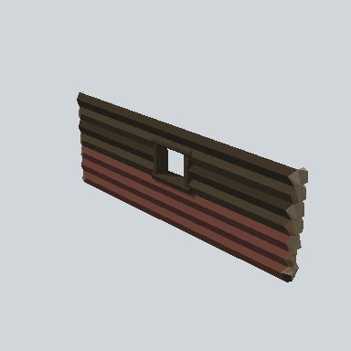

# EA03_Town_Hut_Wall_Painted_Front_02a_PRE

Generated by `tools/assets/gen_prefab_tables.py`: edit only below the Notes heading.

| Field | Value |
| --- | --- |
| Pack | EmaceArt-SlavicWorldFree |
| Path | `Prefabs/Compound/Walls_Painted/EA03_Town_Hut_Wall_Painted_Front_02a_PRE.prefab` |
| GUID | `100539ae3b0bce945a2f6004a921042d` |
| Subgroup | Walls_Painted |
| Size (m) | 8.6 |
| Collider | Mesh |
| LODs | 3 |
| Meshes | `EA03_Village_Hut_Wall_Painted_Front_02a.fbx` |
| Materials | `EA03_LPNP-Slavika_Colorsheet_v1.mat` |
| Nested prefabs | none |
| In demo scene | 0 |
| Bounds W x H x D (m) | 0.59 x 3.09 x 8.56 |
| Footprint (m) | 0.6 x 8.6 |
| Pivot | bottom at y = -0.00; center offset x 0.00, z 0.00 |
| Triangles / vertices (LOD0) | 390 / 831 |
| Average color | `#423127` |
| Dominant colors | `#3B2E24` 25%, `#2E231C` 19%, `#684036` 19% |

Colors are read from the rendered preview, so they include lighting. Bounds cover LOD0 renderers.

## Notes

TODO: hand-written usage notes.
