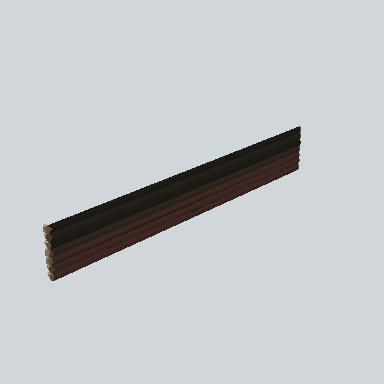

# EA03_Town_Hut_Wall_Painted_Side_02c_PRE

Generated by `tools/assets/gen_prefab_tables.py`: edit only below the Notes heading.

| Field | Value |
| --- | --- |
| Pack | EmaceArt-SlavicWorldFree |
| Path | `Prefabs/Compound/Walls_Painted/EA03_Town_Hut_Wall_Painted_Side_02c_PRE.prefab` |
| GUID | `c51651d067868744cbce58bf2a96a94f` |
| Subgroup | Walls_Painted |
| Size (m) | 20.0 |
| Collider | Mesh |
| LODs | 3 |
| Meshes | `EA03_Village_Hut_Wall_Painted_Side_02c.fbx` |
| Materials | `EA03_LPNP-Slavika_Colorsheet_v1.mat` |
| Nested prefabs | none |
| In demo scene | 0 |
| Bounds W x H x D (m) | 20.02 x 3.09 x 0.55 |
| Footprint (m) | 20.0 x 0.5 |
| Pivot | bottom at y = -0.00; center offset x 0.00, z 0.00 |
| Triangles / vertices (LOD0) | 307 / 677 |
| Average color | `#2C221C` |
| Dominant colors | `#2C221C` 36%, `#1B1916` 30%, `#3E2722` 23% |

Colors are read from the rendered preview, so they include lighting. Bounds cover LOD0 renderers.

## Notes

TODO: hand-written usage notes.
