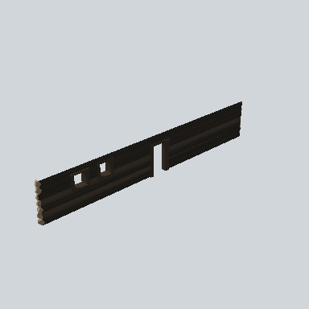

# EA03_Town_Hut_Wall_Painted_Side_02e_PRE

Generated by `tools/assets/gen_prefab_tables.py`: edit only below the Notes heading.

| Field | Value |
| --- | --- |
| Pack | EmaceArt-SlavicWorldFree |
| Path | `Prefabs/Compound/Walls_Painted/EA03_Town_Hut_Wall_Painted_Side_02e_PRE.prefab` |
| GUID | `87ad4bd871d2ab6458839424117f7180` |
| Subgroup | Walls_Painted |
| Size (m) | 20.0 |
| Collider | Box |
| LODs | 3 |
| Meshes | `EA03_Village_Hut_Wall_Painted_Side_02e.fbx` |
| Materials | `EA03_LPNP-Slavika_Colorsheet_v1.mat` |
| Nested prefabs | none |
| In demo scene | 0 |
| Bounds W x H x D (m) | 19.97 x 3.13 x 0.85 |
| Footprint (m) | 20.0 x 0.8 |
| Pivot | bottom at y = 0.00; center offset x -0.00, z 0.07 |
| Triangles / vertices (LOD0) | 783 / 1,505 |
| Average color | `#211E19` |
| Dominant colors | `#1B1916` 67%, `#29241D` 21%, `#211D18` 7% |

Colors are read from the rendered preview, so they include lighting. Bounds cover LOD0 renderers.

## Notes

TODO: hand-written usage notes.
