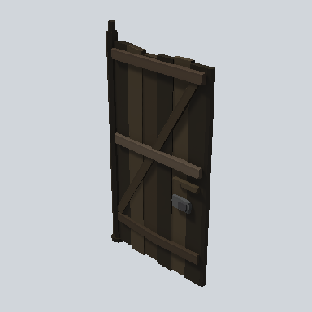

# EA03_Prop_House_Door_01b_PRE

Generated by `tools/assets/gen_prefab_tables.py`: edit only below the Notes heading.

| Field | Value |
| --- | --- |
| Pack | EmaceArt-SlavicWorldFree |
| Path | `Prefabs/Environment/EA03_Prop_House_Door_01b_PRE.prefab` |
| GUID | `baa6dbec3eebc054d96e5e02272fd7ea` |
| Subgroup | - |
| Size (m) | 2.5 |
| Collider | Mesh |
| LODs | 3 |
| Meshes | `EA03_Prop_House_Door_01b.fbx` |
| Materials | `EA03_LPNP-Slavika_Colorsheet_v1.mat` |
| Nested prefabs | none |
| In demo scene | 0 |
| Bounds W x H x D (m) | 0.18 x 2.53 x 1.39 |
| Footprint (m) | 0.2 x 1.4 |
| Pivot | bottom at y = 0.00; center offset x -0.01, z 0.61 |
| Triangles / vertices (LOD0) | 516 / 906 |
| Average color | `#2A251E` |
| Dominant colors | `#362E24` 29%, `#27221B` 29%, `#1A1714` 23% |

Colors are read from the rendered preview, so they include lighting. Bounds cover LOD0 renderers.

## Notes

TODO: hand-written usage notes.
