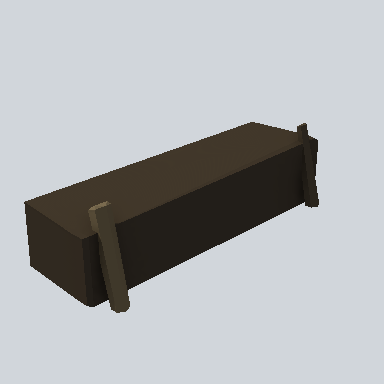

# EA03_Step_01b_PRE

Generated by `tools/assets/gen_prefab_tables.py`: edit only below the Notes heading.

| Field | Value |
| --- | --- |
| Pack | EmaceArt-SlavicWorldFree |
| Path | `Prefabs/Environment/EA03_Step_01b_PRE.prefab` |
| GUID | `72a62258ff91e7a468e5877a9f60549b` |
| Subgroup | - |
| Size (m) | 2.5 |
| Collider | Mesh |
| LODs | 3 |
| Meshes | `EA03_Step_01b.fbx` |
| Materials | `EA03_LPNP-Slavika_Colorsheet_v1.mat` |
| Nested prefabs | none |
| In demo scene | 0 |
| Bounds W x H x D (m) | 2.46 x 0.72 x 0.93 |
| Footprint (m) | 2.5 x 0.9 |
| Pivot | bottom at y = -0.45; center offset x -0.02, z -0.23 |
| Triangles / vertices (LOD0) | 61 / 131 |
| Average color | `#302920` |
| Dominant colors | `#211D18` 38%, `#413729` 33%, `#373024` 17% |

Colors are read from the rendered preview, so they include lighting. Bounds cover LOD0 renderers.

## Notes

TODO: hand-written usage notes.
