# Environment

**Prefabs: 41**

Ground-level pieces that are not buildings or plants: roads, flat ground
patches, rocks, bridges, stairs. Every prefab has its own card; see [Prefabs](#prefabs).

| Subgroup | Count | Size (m) | What it is |
| --- | --- | --- | --- |
Sizes are measured W x H x D in meters, from the previews' bounds.

| Subgroup | Count | What it looks like |
| --- | --- | --- |
| `Road` | 5 | grey cobble road strips: `Cobble_01a` is 5.2 x 1.8, `01b` 1.8 x 1.7, `Corner_01a` 3.7 x 3.5; plus a dark wooden road (3.1 x 1.3) and a wooden platform (2.9 x 5.4) |
| `RoadIsland` | 5 | not road surface: `08`, `08a` are grass verge strips with stones (8.6 and 3.9 m long); `01_Small`, `09`, `09a` are 18 - 19 m trails of loose grey pebbles |
| `RoadSide` | 1 | 4.2 m dark-earth curb strip studded with grey stones |
| `Sand` | 6 | flat tan sand mounds (`Sand_Flat_01b` 12.8 x 10.9 m with a raised rim), mud flats, and `Nature_Bush_Flat_03e`: the same 19.6 x 13.7 m terraced mesh as `Rock/Nature_Solid_Flat_01a`, colored moss green |
| `Mud` | 5 | flat brown puddle patches, 5.5 m (`Mud_Flat_01b`, `Mud_04b`), and 3.9 m mud strips |
| `Rock` | 12 | see below |
| `Bridge` | 2 | dark wooden piers, 6.6 and 4.6 m long, 2.5 m tall |
| `Stairs` | 1 | wooden stair, 5.2 m tall, 2.2 m of it below the pivot |
| `Moss` | 1 | 2.9 x 3.2 m flat moss mat, no collider |
| (root) | 3 | a cobble stair, a door, a step |

Rocks, by use:

| Use | Prefabs |
| --- | --- |
| cliff or pillar | `Env_Rock_Slice_01a`: a 6.0 m tall rock pillar, the only vertical rock |
| large slabs and ledges | `Rock_Flat_04c`, `Rock_Flat_04c_Flat` (19.6 x 6.3 x 11.5, same mesh), `Nature_Solid_Flat_01a/b/c` (16 - 20 m terraced stone platforms) |
| boulder clusters | `Rock_CatHead_01b` (6.0 x 7.1, four boulders), `Rock_Mini_CatHead_01a` (4.5 x 4.7), `EnvRock_01a` (6.6 x 3.7 flat) |
| scatter | `Rock_Mini_Head_01a` (1.5 m, 45 in the demo scene), `Rock_BIG_Head_01b` (1.0 m), `Rock_Big_Head_01a` (0.6 m). "Big" is only relative |

## Using it in a map

- Cobble roads are narrow 1.8 m strips, so a lane is one tile wide and turns
  use the 3.7 m corner. Only 10 road instances appear in the demo scene.
- `RoadIsland` pebble trails mark footpaths through grass without a paved
  surface; the grass verges go between road and field.
- Sand, mud and moss are flat patches that sit on top of terrain. They suit
  clearings, puddles and transitions, not a whole region.
- For the grey rock rims in the sample map: line borders with the large slabs
  and boulder clusters, and use `Rock_Slice_01a` for vertical accents.

## Gaps

- No cliff-wall module: one 6 m pillar is the tallest rock.
- No sea, lake or beach edge.

## Prefabs

<!-- PREFAB-INDEX:START (generated) -->

**41 prefabs**, one card each.

| Preview | Subgroup | Prefab | W x H x D (m) | Main color | In scene |
| --- | --- | --- | --- | --- | --- |
| 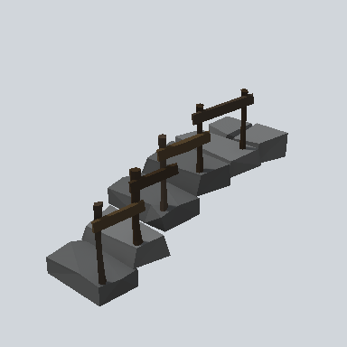 | - | [EA03_Environment_Road_Cobble_Staris_01b_PRE](EA03_Environment_Road_Cobble_Staris_01b_PRE.md) | 5.1 x 3.1 x 1.9 | `#4E4F50` | - |
|  | - | [EA03_Prop_House_Door_01b_PRE](EA03_Prop_House_Door_01b_PRE.md) | 0.2 x 2.5 x 1.4 | `#362E24` | - |
|  | - | [EA03_Step_01b_PRE](EA03_Step_01b_PRE.md) | 2.5 x 0.7 x 0.9 | `#211D18` | - |
| 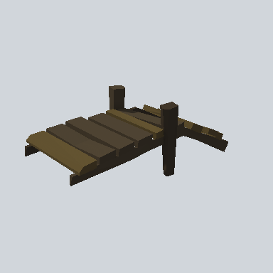 | Bridge | [EA03_Prop_Pier_03d_PRE](Bridge/EA03_Prop_Pier_03d_PRE.md) | 6.6 x 2.5 x 2.6 | `#4E4331` | - |
| 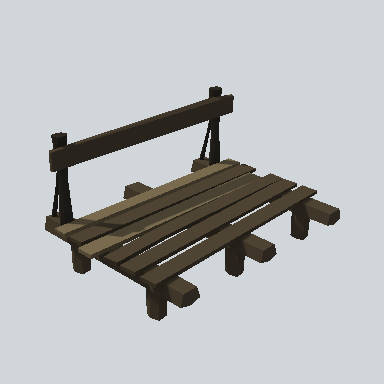 | Bridge | [EA03_Prop_Pier_04c_PRE](Bridge/EA03_Prop_Pier_04c_PRE.md) | 4.6 x 2.5 x 3.5 | `#4E4332` | - |
| 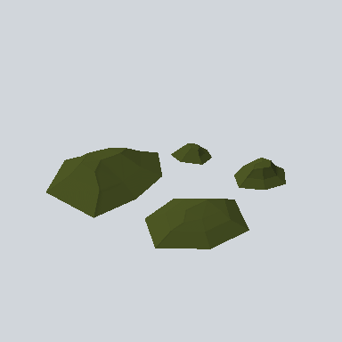 | Moss | [EA03_Environment_Moss_01_PRE](Moss/EA03_Environment_Moss_01_PRE.md) | 2.9 x 0.3 x 3.2 | `#475121` | - |
| 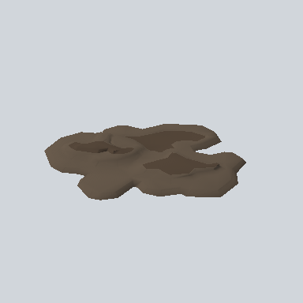 | Mud | [EA03_Env_Mud_Flat_01b_PRE](Mud/EA03_Env_Mud_Flat_01b_PRE.md) | 5.5 x 0.4 x 5.7 | `#635548` | - |
|  | Mud | [EA03_Env_Mud_Flat_01b_x_PRE](Mud/EA03_Env_Mud_Flat_01b_x_PRE.md) | 5.5 x 0.4 x 5.7 | `#635548` | - |
| 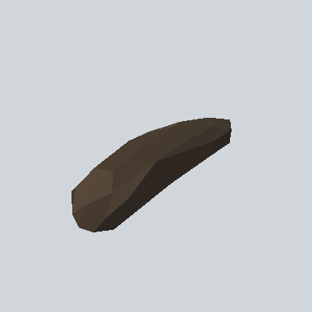 | Mud | [EA03_Env_RoadIslandMud_01a_PRE](Mud/EA03_Env_RoadIslandMud_01a_PRE.md) | 3.9 x 0.4 x 1.8 | `#463B2F` | - |
| 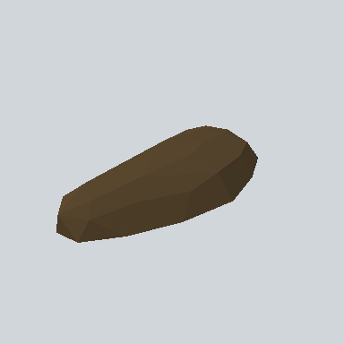 | Mud | [EA03_Env_RoadIslandMud_01b_PRE](Mud/EA03_Env_RoadIslandMud_01b_PRE.md) | 3.9 x 0.3 x 2.0 | `#54432B` | - |
| 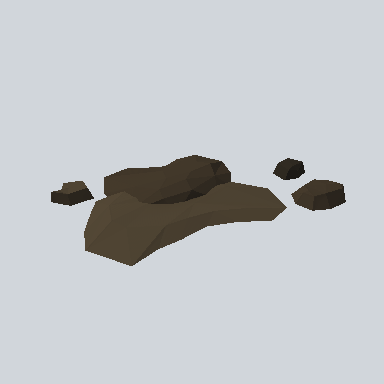 | Mud | [EA03_Environment_Mud_04b_PRE](Mud/EA03_Environment_Mud_04b_PRE.md) | 5.5 x 0.4 x 4.4 | `#4E4332` | - |
| 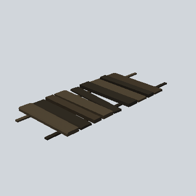 | Road | [EA03_Env_Road_Wooden_01d_PRE](Road/EA03_Env_Road_Wooden_01d_PRE.md) | 3.1 x 0.1 x 1.3 | `#2F2A21` | - |
| 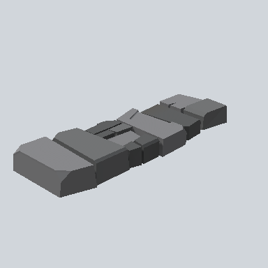 | Road | [EA03_Environment_Road_Cobble_01a_PRE](Road/EA03_Environment_Road_Cobble_01a_PRE.md) | 5.2 x 0.6 x 1.8 | `#6D6D6E` | 7 |
| 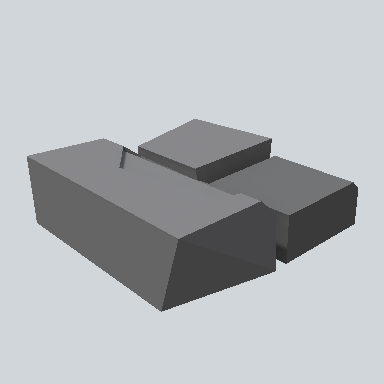 | Road | [EA03_Environment_Road_Cobble_01b_PRE](Road/EA03_Environment_Road_Cobble_01b_PRE.md) | 1.8 x 0.5 x 1.7 | `#69696A` | 2 |
|  | Road | [EA03_Environment_Road_Cobble_Corner_01a_PRE](Road/EA03_Environment_Road_Cobble_Corner_01a_PRE.md) | 3.7 x 0.6 x 3.5 | `#6C6D6E` | 1 |
| 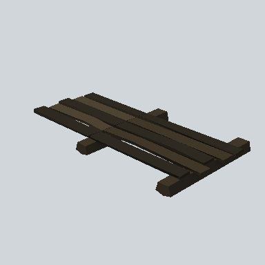 | Road | [EA03_Village_platform_01a_PRE](Road/EA03_Village_platform_01a_PRE.md) | 2.9 x 0.4 x 5.4 | `#2F2A21` | - |
|  | RoadIsland | [EA03_Environment_RoadIsland_01_Small_PRE](RoadIsland/EA03_Environment_RoadIsland_01_Small_PRE.md) | 18.7 x 0.6 x 3.9 | `#52504E` | - |
|  | RoadIsland | [EA03_Environment_RoadIsland_08_PRE](RoadIsland/EA03_Environment_RoadIsland_08_PRE.md) | 8.6 x 0.6 x 3.3 | `#4B5524` | - |
| 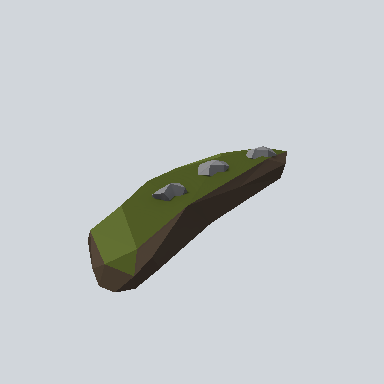 | RoadIsland | [EA03_Environment_RoadIsland_08a_PRE](RoadIsland/EA03_Environment_RoadIsland_08a_PRE.md) | 3.9 x 0.4 x 1.8 | `#4E5526` | - |
|  | RoadIsland | [EA03_Environment_RoadIsland_09_PRE](RoadIsland/EA03_Environment_RoadIsland_09_PRE.md) | 18.7 x 0.6 x 3.9 | `#52504E` | - |
| 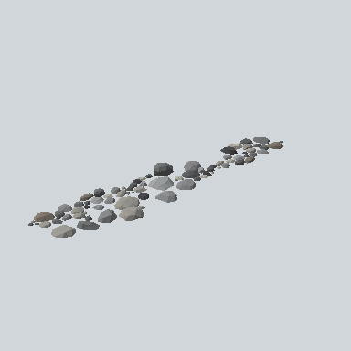 | RoadIsland | [EA03_Environment_RoadIsland_09a_PRE](RoadIsland/EA03_Environment_RoadIsland_09a_PRE.md) | 18.0 x 0.6 x 4.0 | `#90908E` | - |
| 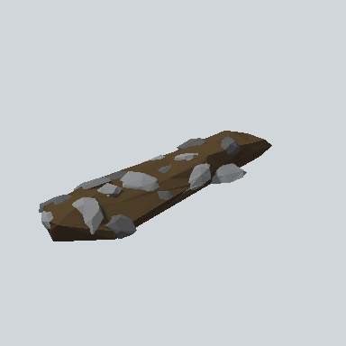 | RoadSide | [EA03_Environment_RoadSide_PRE](RoadSide/EA03_Environment_RoadSide_PRE.md) | 4.2 x 0.4 x 1.3 | `#56442C` | - |
|  | Rock | [EA03_EnvRock_01a_PRE](Rock/EA03_EnvRock_01a_PRE.md) | 6.6 x 0.6 x 3.7 | `#8D8E8F` | - |
| 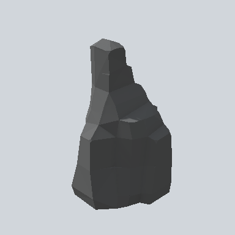 | Rock | [EA03_Env_Rock_Slice_01a_PRE](Rock/EA03_Env_Rock_Slice_01a_PRE.md) | 3.6 x 6.0 x 3.7 | `#3A3B3B` | - |
| 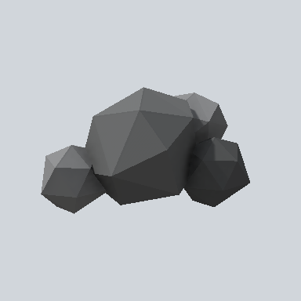 | Rock | [EA03_Environment_Rock_BIG_Head_01b_PRE](Rock/EA03_Environment_Rock_BIG_Head_01b_PRE.md) | 1.0 x 0.5 x 0.7 | `#323232` | - |
|  | Rock | [EA03_Environment_Rock_Big_Head_01a_PRE](Rock/EA03_Environment_Rock_Big_Head_01a_PRE.md) | 0.6 x 0.5 x 0.5 | `#6F7071` | - |
|  | Rock | [EA03_Environment_Rock_CatHead_01b_PRE](Rock/EA03_Environment_Rock_CatHead_01b_PRE.md) | 6.0 x 1.7 x 7.1 | `#6E6F70` | - |
|  | Rock | [EA03_Environment_Rock_Flat_04c_Flat_PRE](Rock/EA03_Environment_Rock_Flat_04c_Flat_PRE.md) | 19.6 x 6.3 x 11.5 | `#464748` | - |
|  | Rock | [EA03_Environment_Rock_Flat_04c_PRE](Rock/EA03_Environment_Rock_Flat_04c_PRE.md) | 19.6 x 6.3 x 11.5 | `#464748` | - |
| 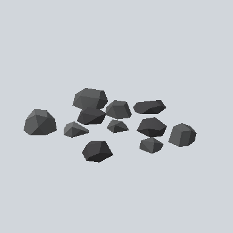 | Rock | [EA03_Environment_Rock_Mini_CatHead_01a_PRE](Rock/EA03_Environment_Rock_Mini_CatHead_01a_PRE.md) | 4.5 x 0.7 x 4.7 | `#4C4D4E` | - |
| 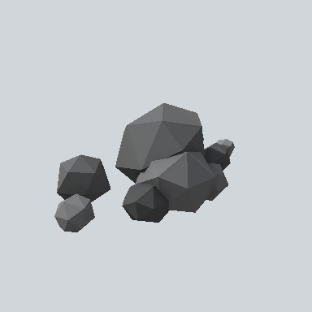 | Rock | [EA03_Environment_Rock_Mini_Head_01a_PRE](Rock/EA03_Environment_Rock_Mini_Head_01a_PRE.md) | 1.5 x 0.5 x 0.8 | `#4D4E4F` | 45 |
| 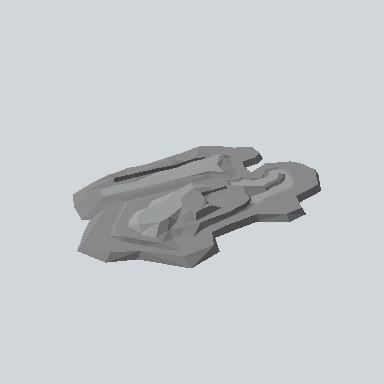 | Rock | [EA03_Nature_Solid_Flat_01a_PRE](Rock/EA03_Nature_Solid_Flat_01a_PRE.md) | 19.6 x 1.1 x 13.7 | `#8B8C8E` | - |
| 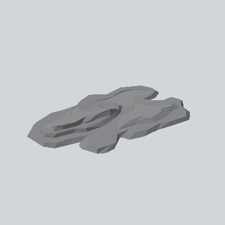 | Rock | [EA03_Nature_Solid_Flat_01b_PRE](Rock/EA03_Nature_Solid_Flat_01b_PRE.md) | 16.4 x 1.0 x 11.2 | `#88898C` | - |
| 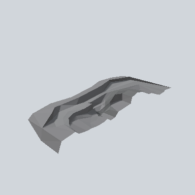 | Rock | [EA03_Nature_Solid_Flat_01c_PRE](Rock/EA03_Nature_Solid_Flat_01c_PRE.md) | 16.4 x 2.3 x 7.4 | `#8B8B8E` | - |
|  | Sand | [EA03_Env_Mud_Flat_01c_Half_PRE](Sand/EA03_Env_Mud_Flat_01c_Half_PRE.md) | 8.1 x 0.4 x 3.1 | `#635648` | - |
| 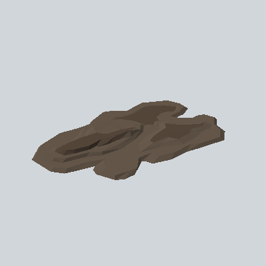 | Sand | [EA03_Env_Mud_Flat_01c_PRE](Sand/EA03_Env_Mud_Flat_01c_PRE.md) | 8.3 x 0.4 x 5.6 | `#635648` | - |
| 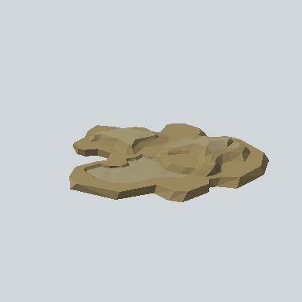 | Sand | [EA03_Env_Sand_Flat_01a_PRE](Sand/EA03_Env_Sand_Flat_01a_PRE.md) | 4.6 x 0.4 x 4.8 | `#98875D` | - |
| 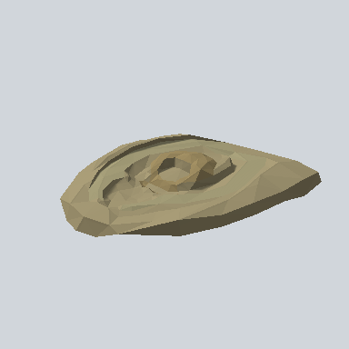 | Sand | [EA03_Env_Sand_Flat_01b_PRE](Sand/EA03_Env_Sand_Flat_01b_PRE.md) | 12.8 x 1.7 x 10.9 | `#978D6B` | - |
|  | Sand | [EA03_Environment_Sand_01b_PRE](Sand/EA03_Environment_Sand_01b_PRE.md) | 8.8 x 0.8 x 7.1 | `#77684E` | - |
| 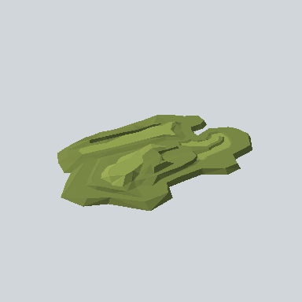 | Sand | [EA03_Nature_Bush_Flat_03e_PRE](Sand/EA03_Nature_Bush_Flat_03e_PRE.md) | 19.6 x 1.1 x 13.7 | `#788644` | - |
| 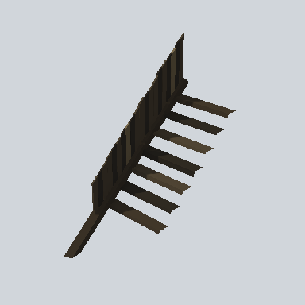 | Stairs | [EA03_Village_step_platform_Stair_R_03a_PRE](Stairs/EA03_Village_step_platform_Stair_R_03a_PRE.md) | 4.6 x 5.2 x 2.1 | `#27231C` | - |

<!-- PREFAB-INDEX:END -->
