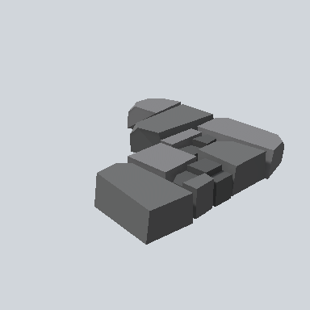

# EA03_Environment_Road_Cobble_Corner_01a_PRE

Generated by `tools/assets/gen_prefab_tables.py`: edit only below the Notes heading.

| Field | Value |
| --- | --- |
| Pack | EmaceArt-SlavicWorldFree |
| Path | `Prefabs/Environment/Road/EA03_Environment_Road_Cobble_Corner_01a_PRE.prefab` |
| GUID | `c4ed780c30c7f004b812e991fe6d7d48` |
| Subgroup | Road |
| Size (m) | 3.7 |
| Collider | Mesh |
| LODs | 3 |
| Meshes | `EA03_Environment_Road_Cobble_Corner_01a.fbx` |
| Materials | `EA03_LPNP-Slavika_Colorsheet_v1.mat` |
| Nested prefabs | none |
| In demo scene | 1 |
| Bounds W x H x D (m) | 3.71 x 0.55 x 3.53 |
| Footprint (m) | 3.7 x 3.5 |
| Pivot | bottom at y = -0.13; center offset x 0.16, z 0.05 |
| Triangles / vertices (LOD0) | 163 / 337 |
| Average color | `#5F6061` |
| Dominant colors | `#6C6D6E` 42%, `#373838` 27%, `#87878A` 17% |

Colors are read from the rendered preview, so they include lighting. Bounds cover LOD0 renderers.

## Notes

TODO: hand-written usage notes.
