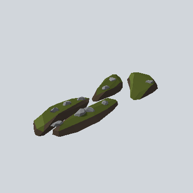

# EA03_Environment_RoadIsland_08_PRE

Generated by `tools/assets/gen_prefab_tables.py`: edit only below the Notes heading.

| Field | Value |
| --- | --- |
| Pack | EmaceArt-SlavicWorldFree |
| Path | `Prefabs/Environment/RoadIsland/EA03_Environment_RoadIsland_08_PRE.prefab` |
| GUID | `c8b8cb715a48ad741a381e3614f06b0e` |
| Subgroup | RoadIsland |
| Size (m) | 8.6 |
| Collider | Mesh |
| LODs | 3 |
| Meshes | `EA03_Environment_RoadIsland_08.fbx` |
| Materials | `EA03_LPNP-Slavika_Colorsheet_v1.mat` |
| Nested prefabs | none |
| In demo scene | 0 |
| Bounds W x H x D (m) | 8.56 x 0.57 x 3.28 |
| Footprint (m) | 8.6 x 3.3 |
| Pivot | bottom at y = -0.01; center offset x 0.37, z -0.09 |
| Triangles / vertices (LOD0) | 386 / 931 |
| Average color | `#45482C` |
| Dominant colors | `#4B5524` 44%, `#302822` 28%, `#463A2F` 6% |

Colors are read from the rendered preview, so they include lighting. Bounds cover LOD0 renderers.

## Notes

TODO: hand-written usage notes.
