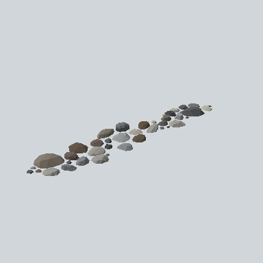

# EA03_Environment_RoadIsland_09_PRE

Generated by `tools/assets/gen_prefab_tables.py`: edit only below the Notes heading.

| Field | Value |
| --- | --- |
| Pack | EmaceArt-SlavicWorldFree |
| Path | `Prefabs/Environment/RoadIsland/EA03_Environment_RoadIsland_09_PRE.prefab` |
| GUID | `985c93ec7deb84d458a6305eed38cccf` |
| Subgroup | RoadIsland |
| Size (m) | 18.7 |
| Collider | Mesh |
| LODs | 3 |
| Meshes | `EA03_Environment_RoadIsland_09.fbx` |
| Materials | `EA03_LPNP-Slavika_Colorsheet_v1.mat` |
| Nested prefabs | none |
| In demo scene | 0 |
| Bounds W x H x D (m) | 18.74 x 0.60 x 3.95 |
| Footprint (m) | 18.7 x 3.9 |
| Pivot | bottom at y = -0.03; center offset x -0.27, z 0.45 |
| Triangles / vertices (LOD0) | 871 / 1,950 |
| Average color | `#6E6B66` |
| Dominant colors | `#52504E` 21%, `#93928F` 18%, `#71706D` 17% |

Colors are read from the rendered preview, so they include lighting. Bounds cover LOD0 renderers.

## Notes

TODO: hand-written usage notes.
