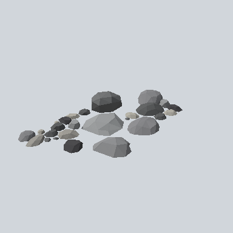

# EA03_EnvRock_01a_PRE

Generated by `tools/assets/gen_prefab_tables.py`: edit only below the Notes heading.

| Field | Value |
| --- | --- |
| Pack | EmaceArt-SlavicWorldFree |
| Path | `Prefabs/Environment/Rock/EA03_EnvRock_01a_PRE.prefab` |
| GUID | `8c52122c59156cb43a6d20cc2533c98a` |
| Subgroup | Rock |
| Size (m) | 6.6 |
| Collider | none |
| LODs | 3 |
| Meshes | `EA03_EnvRock_01a.fbx` |
| Materials | `EA03_LPNP-Slavika_Colorsheet_v1.mat` |
| Nested prefabs | none |
| In demo scene | 0 |
| Bounds W x H x D (m) | 6.56 x 0.61 x 3.68 |
| Footprint (m) | 6.6 x 3.7 |
| Pivot | bottom at y = -0.00; center offset x 0.31, z 0.56 |
| Triangles / vertices (LOD0) | 548 / 1,430 |
| Average color | `#717272` |
| Dominant colors | `#8D8E8F` 36%, `#4D4E50` 22%, `#707172` 20% |

Colors are read from the rendered preview, so they include lighting. Bounds cover LOD0 renderers.

## Notes

TODO: hand-written usage notes.
