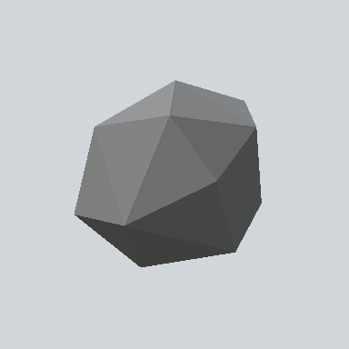

# EA03_Environment_Rock_Big_Head_01a_PRE

Generated by `tools/assets/gen_prefab_tables.py`: edit only below the Notes heading.

| Field | Value |
| --- | --- |
| Pack | EmaceArt-SlavicWorldFree |
| Path | `Prefabs/Environment/Rock/EA03_Environment_Rock_Big_Head_01a_PRE.prefab` |
| GUID | `0d3784e80d2c3074bb909d9cdd536402` |
| Subgroup | Rock |
| Size (m) | 0.6 |
| Collider | Mesh |
| LODs | 3 |
| Meshes | `EA03_Environment_Rock_Head_01a.fbx` |
| Materials | `EA03_LPNP-Slavika_Colorsheet_v1.mat` |
| Nested prefabs | none |
| In demo scene | 0 |
| Bounds W x H x D (m) | 0.61 x 0.50 x 0.54 |
| Footprint (m) | 0.6 x 0.5 |
| Pivot | bottom at y = -0.22; center offset x -0.02, z -0.02 |
| Triangles / vertices (LOD0) | 28 / 84 |
| Average color | `#656667` |
| Dominant colors | `#6F7071` 34%, `#454647` 26%, `#868788` 23% |

Colors are read from the rendered preview, so they include lighting. Bounds cover LOD0 renderers.

## Notes

TODO: hand-written usage notes.
