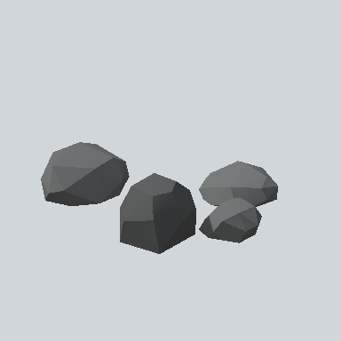

# EA03_Environment_Rock_CatHead_01b_PRE

Generated by `tools/assets/gen_prefab_tables.py`: edit only below the Notes heading.

| Field | Value |
| --- | --- |
| Pack | EmaceArt-SlavicWorldFree |
| Path | `Prefabs/Environment/Rock/EA03_Environment_Rock_CatHead_01b_PRE.prefab` |
| GUID | `d4c3b8efab3e0cc4f9c5e7d47142f18c` |
| Subgroup | Rock |
| Size (m) | 7.1 |
| Collider | Mesh |
| LODs | 3 |
| Meshes | `EA03_Environment_Rock_CatHead_01b.fbx` |
| Materials | `EA03_LPNP-Slavika_Colorsheet_v1.mat` |
| Nested prefabs | none |
| In demo scene | 0 |
| Bounds W x H x D (m) | 6.02 x 1.65 x 7.08 |
| Footprint (m) | 6.0 x 7.1 |
| Pivot | bottom at y = -0.48; center offset x -0.52, z -0.53 |
| Triangles / vertices (LOD0) | 131 / 306 |
| Average color | `#525354` |
| Dominant colors | `#6E6F70` 35%, `#4C4D4E` 32%, `#353636` 24% |

Colors are read from the rendered preview, so they include lighting. Bounds cover LOD0 renderers.

## Notes

TODO: hand-written usage notes.
