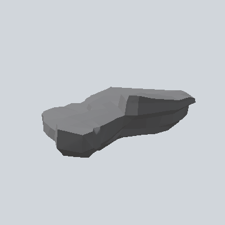

# EA03_Environment_Rock_Flat_04c_PRE

Generated by `tools/assets/gen_prefab_tables.py`: edit only below the Notes heading.

| Field | Value |
| --- | --- |
| Pack | EmaceArt-SlavicWorldFree |
| Path | `Prefabs/Environment/Rock/EA03_Environment_Rock_Flat_04c_PRE.prefab` |
| GUID | `1d92f26bf55fcc24583880399688e793` |
| Subgroup | Rock |
| Size (m) | 19.6 |
| Collider | Mesh |
| LODs | 3 |
| Meshes | `EA03_Environment_Rock_Flat_04c.fbx` |
| Materials | `EA03_LPNP-Slavika_Colorsheet_v1.mat` |
| Nested prefabs | none |
| In demo scene | 0 |
| Bounds W x H x D (m) | 19.62 x 6.31 x 11.51 |
| Footprint (m) | 19.6 x 11.5 |
| Pivot | bottom at y = -1.79; center offset x -0.28, z -0.38 |
| Triangles / vertices (LOD0) | 624 / 1,222 |
| Average color | `#626364` |
| Dominant colors | `#464748` 42%, `#868789` 40%, `#3C3C3C` 8% |

Colors are read from the rendered preview, so they include lighting. Bounds cover LOD0 renderers.

## Notes

TODO: hand-written usage notes.
