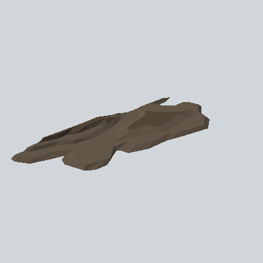

# EA03_Env_Mud_Flat_01c_Half_PRE

Generated by `tools/assets/gen_prefab_tables.py`: edit only below the Notes heading.

| Field | Value |
| --- | --- |
| Pack | EmaceArt-SlavicWorldFree |
| Path | `Prefabs/Environment/Sand/EA03_Env_Mud_Flat_01c_Half_PRE.prefab` |
| GUID | `774d5f7ba4cad4941bcac5dbcd200095` |
| Subgroup | Sand |
| Size (m) | 8.1 |
| Collider | Mesh |
| LODs | 3 |
| Meshes | `EA03_Env_Mud_Flat_01c_Half.fbx` |
| Materials | `EA03_LPNP-Slavika_Colorsheet_v1.mat` |
| Nested prefabs | none |
| In demo scene | 0 |
| Bounds W x H x D (m) | 8.09 x 0.35 x 3.11 |
| Footprint (m) | 8.1 x 3.1 |
| Pivot | bottom at y = 0.00; center offset x 0.17, z 1.54 |
| Triangles / vertices (LOD0) | 267 / 540 |
| Average color | `#5A4E41` |
| Dominant colors | `#635648` 51%, `#514539` 25%, `#5B4F42` 17% |

Colors are read from the rendered preview, so they include lighting. Bounds cover LOD0 renderers.

## Notes

TODO: hand-written usage notes.
