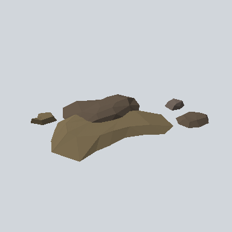

# EA03_Environment_Sand_01b_PRE

Generated by `tools/assets/gen_prefab_tables.py`: edit only below the Notes heading.

| Field | Value |
| --- | --- |
| Pack | EmaceArt-SlavicWorldFree |
| Path | `Prefabs/Environment/Sand/EA03_Environment_Sand_01b_PRE.prefab` |
| GUID | `9c355eebb616ba247ad9f413462735ac` |
| Subgroup | Sand |
| Size (m) | 8.9 |
| Collider | Mesh |
| LODs | 3 |
| Meshes | `EA03_Environment_Sand_01b.fbx` |
| Materials | `EA03_LPNP-Slavika_Colorsheet_v1.mat` |
| Nested prefabs | none |
| In demo scene | 0 |
| Bounds W x H x D (m) | 8.82 x 0.75 x 7.13 |
| Footprint (m) | 8.8 x 7.1 |
| Pivot | bottom at y = -0.14; center offset x -0.44, z 1.97 |
| Triangles / vertices (LOD0) | 149 / 354 |
| Average color | `#6A5D48` |
| Dominant colors | `#77684E` 42%, `#665947` 34%, `#53483A` 7% |

Colors are read from the rendered preview, so they include lighting. Bounds cover LOD0 renderers.

## Notes

TODO: hand-written usage notes.
