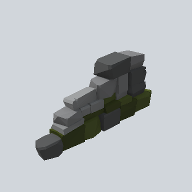

# EA03_Fence_Cobble_01a_PRE

Generated by `tools/assets/gen_prefab_tables.py`: edit only below the Notes heading.

| Field | Value |
| --- | --- |
| Pack | EmaceArt-SlavicWorldFree |
| Path | `Prefabs/Fence/Cobble/EA03_Fence_Cobble_01a_PRE.prefab` |
| GUID | `3db120a6c4288974c99d5e60c01fff6a` |
| Subgroup | Cobble |
| Size (m) | 3.8 |
| Collider | Mesh |
| LODs | 3 |
| Meshes | `EA03_Fence_Cobble_01a.fbx` |
| Materials | `EA03_LPNP-Slavika_Colorsheet_v1.mat` |
| Nested prefabs | none |
| In demo scene | 0 |
| Bounds W x H x D (m) | 3.79 x 1.64 x 0.78 |
| Footprint (m) | 3.8 x 0.8 |
| Pivot | bottom at y = 0.00; center offset x 0.17, z -0.08 |
| Triangles / vertices (LOD0) | 534 / 1,083 |
| Average color | `#43453F` |
| Dominant colors | `#4C4D4E` 30%, `#2F3030` 26%, `#282E17` 26% |

Colors are read from the rendered preview, so they include lighting. Bounds cover LOD0 renderers.

## Notes

TODO: hand-written usage notes.
