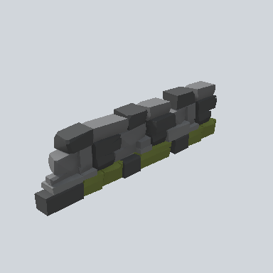

# EA03_Fence_Cobble_01b_PRE

Generated by `tools/assets/gen_prefab_tables.py`: edit only below the Notes heading.

| Field | Value |
| --- | --- |
| Pack | EmaceArt-SlavicWorldFree |
| Path | `Prefabs/Fence/Cobble/EA03_Fence_Cobble_01b_PRE.prefab` |
| GUID | `f16024fa2379f1c498acbd0c8d882355` |
| Subgroup | Cobble |
| Size (m) | 6.3 |
| Collider | Mesh |
| LODs | 3 |
| Meshes | `EA03_Fence_Cobble_01b.fbx` |
| Materials | `EA03_LPNP-Slavika_Colorsheet_v1.mat` |
| Nested prefabs | none |
| In demo scene | 0 |
| Bounds W x H x D (m) | 6.26 x 1.64 x 0.79 |
| Footprint (m) | 6.3 x 0.8 |
| Pivot | bottom at y = 0.00; center offset x 0.10, z -0.06 |
| Triangles / vertices (LOD0) | 866 / 1,470 |
| Average color | `#464843` |
| Dominant colors | `#494A4B` 37%, `#2F3031` 36%, `#485128` 13% |

Colors are read from the rendered preview, so they include lighting. Bounds cover LOD0 renderers.

## Notes

TODO: hand-written usage notes.
