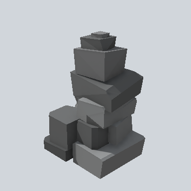

# EA03_Fence_Cobble_End_01a_PRE

Generated by `tools/assets/gen_prefab_tables.py`: edit only below the Notes heading.

| Field | Value |
| --- | --- |
| Pack | EmaceArt-SlavicWorldFree |
| Path | `Prefabs/Fence/Cobble/EA03_Fence_Cobble_End_01a_PRE.prefab` |
| GUID | `df5a0e491576a0a49b2840cf1e111294` |
| Subgroup | Cobble |
| Size (m) | 2.3 |
| Collider | Mesh |
| LODs | 3 |
| Meshes | `EA03_Fence_Cobble_End_01a.fbx` |
| Materials | `EA03_LPNP-Slavika_Colorsheet_v1.mat` |
| Nested prefabs | none |
| In demo scene | 0 |
| Bounds W x H x D (m) | 1.42 x 2.30 x 1.56 |
| Footprint (m) | 1.4 x 1.6 |
| Pivot | bottom at y = 0.00; center offset x 0.03, z 0.02 |
| Triangles / vertices (LOD0) | 293 / 594 |
| Average color | `#525353` |
| Dominant colors | `#4D4E4F` 58%, `#6D6E6F` 20%, `#343535` 16% |

Colors are read from the rendered preview, so they include lighting. Bounds cover LOD0 renderers.

## Notes

TODO: hand-written usage notes.
