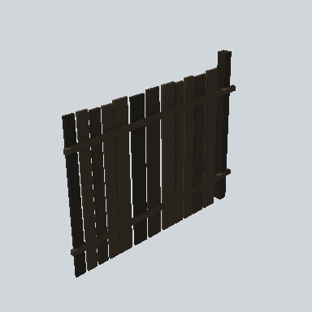

# EA03_Fence_Plank_02a_PRE

Generated by `tools/assets/gen_prefab_tables.py`: edit only below the Notes heading.

| Field | Value |
| --- | --- |
| Pack | EmaceArt-SlavicWorldFree |
| Path | `Prefabs/Fence/Plank2/EA03_Fence_Plank_02a_PRE.prefab` |
| GUID | `eb736a11e2ad7564eb316234731e2539` |
| Subgroup | Plank2 |
| Size (m) | 4.0 |
| Collider | Mesh |
| LODs | 3 |
| Meshes | `EA03_Fence_Plank_02a.fbx` |
| Materials | `EA03_LPNP-Slavika_Colorsheet_v1.mat` |
| Nested prefabs | none |
| In demo scene | 15 |
| Bounds W x H x D (m) | 4.00 x 3.04 x 0.28 |
| Footprint (m) | 4.0 x 0.3 |
| Pivot | bottom at y = 0.00; center offset x 1.83, z -0.02 |
| Triangles / vertices (LOD0) | 154 / 308 |
| Average color | `#24201A` |
| Dominant colors | `#27221B` 53%, `#211D18` 23%, `#1A1815` 19% |

Colors are read from the rendered preview, so they include lighting. Bounds cover LOD0 renderers.

## Notes

TODO: hand-written usage notes.
