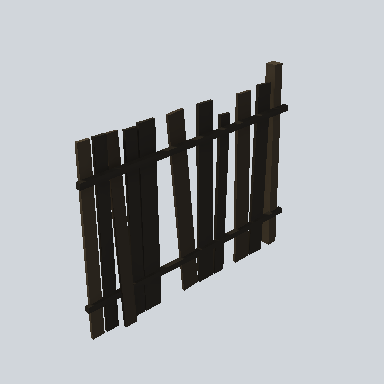

# EA03_Fence_Plank_02b_PRE

Generated by `tools/assets/gen_prefab_tables.py`: edit only below the Notes heading.

| Field | Value |
| --- | --- |
| Pack | EmaceArt-SlavicWorldFree |
| Path | `Prefabs/Fence/Plank2/EA03_Fence_Plank_02b_PRE.prefab` |
| GUID | `020362122a092254db5d9023f1df2599` |
| Subgroup | Plank2 |
| Size (m) | 4.0 |
| Collider | Mesh |
| LODs | 3 |
| Meshes | `EA03_Fence_Plank_02b.fbx` |
| Materials | `EA03_LPNP-Slavika_Colorsheet_v1.mat` |
| Nested prefabs | none |
| In demo scene | 6 |
| Bounds W x H x D (m) | 4.00 x 3.05 x 0.36 |
| Footprint (m) | 4.0 x 0.4 |
| Pivot | bottom at y = -0.01; center offset x 1.83, z 0.02 |
| Triangles / vertices (LOD0) | 134 / 268 |
| Average color | `#201C18` |
| Dominant colors | `#1A1815` 55%, `#211D18` 24%, `#27221B` 15% |

Colors are read from the rendered preview, so they include lighting. Bounds cover LOD0 renderers.

## Notes

TODO: hand-written usage notes.
