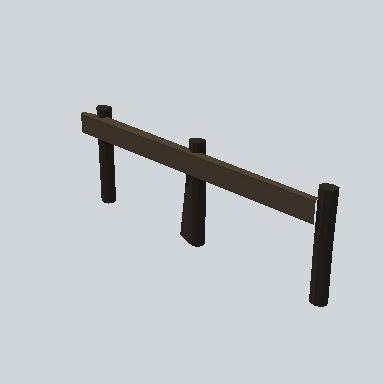

# EA03_Village_Fence_01a_PRE

Generated by `tools/assets/gen_prefab_tables.py`: edit only below the Notes heading.

| Field | Value |
| --- | --- |
| Pack | EmaceArt-SlavicWorldFree |
| Path | `Prefabs/Fence/Plank2/EA03_Village_Fence_01a_PRE.prefab` |
| GUID | `67c45f71b737c68498d0195bc68cefc3` |
| Subgroup | Plank2 |
| Size (m) | 5.2 |
| Collider | Mesh |
| LODs | 3 |
| Meshes | `EA03_Village_Fence_01a.fbx` |
| Materials | `EA03_LPNP-Slavika_Colorsheet_v1.mat` |
| Nested prefabs | none |
| In demo scene | 0 |
| Bounds W x H x D (m) | 0.26 x 1.76 x 5.19 |
| Footprint (m) | 0.3 x 5.2 |
| Pivot | bottom at y = 0.00; center offset x 0.00, z 0.00 |
| Triangles / vertices (LOD0) | 94 / 174 |
| Average color | `#2F2920` |
| Dominant colors | `#393125` 46%, `#1C1916` 33%, `#27221C` 11% |

Colors are read from the rendered preview, so they include lighting. Bounds cover LOD0 renderers.

## Notes

TODO: hand-written usage notes.
