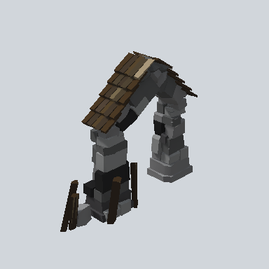

# EA03_Fence_RockGate_01a_PRE

Generated by `tools/assets/gen_prefab_tables.py`: edit only below the Notes heading.

| Field | Value |
| --- | --- |
| Pack | EmaceArt-SlavicWorldFree |
| Path | `Prefabs/Fence/RockGate/EA03_Fence_RockGate_01a_PRE.prefab` |
| GUID | `e784bd578603723449792fd7a2e8a9e3` |
| Subgroup | RockGate |
| Size (m) | 4.3 |
| Collider | Mesh |
| LODs | 3 |
| Meshes | `EA03_Fence_RockGate_01a.fbx` |
| Materials | `EA03_LPNP-Slavika_Colorsheet_v1.mat` |
| Nested prefabs | none |
| In demo scene | 0 |
| Bounds W x H x D (m) | 4.34 x 3.65 x 1.54 |
| Footprint (m) | 4.3 x 1.5 |
| Pivot | bottom at y = -0.01; center offset x 0.31, z 0.11 |
| Triangles / vertices (LOD0) | 2,250 / 4,124 |
| Average color | `#3C3936` |
| Dominant colors | `#494A4B` 29%, `#2F2F2F` 23%, `#191715` 14% |

Colors are read from the rendered preview, so they include lighting. Bounds cover LOD0 renderers.

## Notes

TODO: hand-written usage notes.
