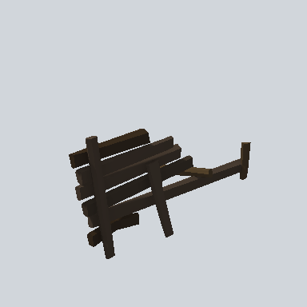

# EA03_Fence_SolidBeam_End_01a_PRE

Generated by `tools/assets/gen_prefab_tables.py`: edit only below the Notes heading.

| Field | Value |
| --- | --- |
| Pack | EmaceArt-SlavicWorldFree |
| Path | `Prefabs/Fence/SolidBeam/EA03_Fence_SolidBeam_End_01a_PRE.prefab` |
| GUID | `79cad5937d8edaa44ab7fd55a6d9a879` |
| Subgroup | SolidBeam |
| Size (m) | 6.2 |
| Collider | Mesh |
| LODs | 3 |
| Meshes | `EA03_Fence_SolidBeam_End_01a.fbx` |
| Materials | `EA03_LPNP-Slavika_Colorsheet_v1.mat` |
| Nested prefabs | none |
| In demo scene | 0 |
| Bounds W x H x D (m) | 6.22 x 3.01 x 3.37 |
| Footprint (m) | 6.2 x 3.4 |
| Pivot | bottom at y = 0.00; center offset x -0.80, z -0.66 |
| Triangles / vertices (LOD0) | 332 / 600 |
| Average color | `#2C251E` |
| Dominant colors | `#2A231D` 59%, `#2F2822` 15%, `#211C16` 15% |

Colors are read from the rendered preview, so they include lighting. Bounds cover LOD0 renderers.

## Notes

TODO: hand-written usage notes.
