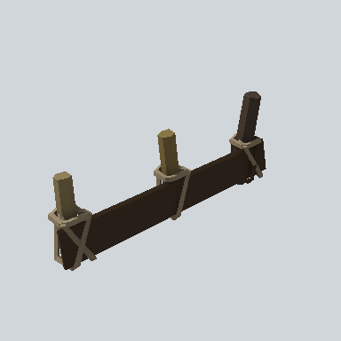

# EA03_Fence_VegetablePatch_02a_PRE

Generated by `tools/assets/gen_prefab_tables.py`: edit only below the Notes heading.

| Field | Value |
| --- | --- |
| Pack | EmaceArt-SlavicWorldFree |
| Path | `Prefabs/Fence/VegetablePatch/EA03_Fence_VegetablePatch_02a_PRE.prefab` |
| GUID | `d661d441d8bd09e46829dbcd7dd65747` |
| Subgroup | VegetablePatch |
| Size (m) | 2.6 |
| Collider | Mesh |
| LODs | 3 |
| Meshes | `EA03_Fence_VegetablePatch_02a.fbx` |
| Materials | `EA03_LPNP-Slavika_Colorsheet_v1.mat` |
| Nested prefabs | none |
| In demo scene | 0 |
| Bounds W x H x D (m) | 2.62 x 0.98 x 0.36 |
| Footprint (m) | 2.6 x 0.4 |
| Pivot | bottom at y = 0.00; center offset x -0.01, z -0.01 |
| Triangles / vertices (LOD0) | 520 / 1,084 |
| Average color | `#3A3024` |
| Dominant colors | `#261E16` 53%, `#504736` 15%, `#2F261C` 11% |

Colors are read from the rendered preview, so they include lighting. Bounds cover LOD0 renderers.

## Notes

TODO: hand-written usage notes.
