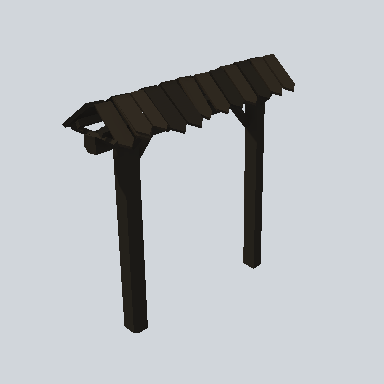

# EA03_Fence_WallGate_01a_PRE

Generated by `tools/assets/gen_prefab_tables.py`: edit only below the Notes heading.

| Field | Value |
| --- | --- |
| Pack | EmaceArt-SlavicWorldFree |
| Path | `Prefabs/Fence/Wall/EA03_Fence_WallGate_01a_PRE.prefab` |
| GUID | `a6fc57c8e1ca6d644b9befadd181a591` |
| Subgroup | Wall |
| Size (m) | 5.0 |
| Collider | Mesh |
| LODs | 3 |
| Meshes | `EA03_Fence_WallGate_01a.fbx` |
| Materials | `EA03_LPNP-Slavika_Colorsheet_v1.mat` |
| Nested prefabs | none |
| In demo scene | 0 |
| Bounds W x H x D (m) | 4.97 x 4.89 x 1.76 |
| Footprint (m) | 5.0 x 1.8 |
| Pivot | bottom at y = -0.00; center offset x 0.00, z -0.08 |
| Triangles / vertices (LOD0) | 587 / 1,153 |
| Average color | `#231F19` |
| Dominant colors | `#27231C` 50%, `#1A1815` 39%, `#302920` 7% |

Colors are read from the rendered preview, so they include lighting. Bounds cover LOD0 renderers.

## Notes

TODO: hand-written usage notes.
