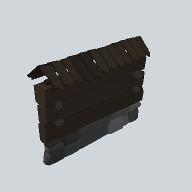

# EA03_Fence_Wall_01b_PRE

Generated by `tools/assets/gen_prefab_tables.py`: edit only below the Notes heading.

| Field | Value |
| --- | --- |
| Pack | EmaceArt-SlavicWorldFree |
| Path | `Prefabs/Fence/Wall/EA03_Fence_Wall_01b_PRE.prefab` |
| GUID | `122f3eba98db0954fb782e8beba20030` |
| Subgroup | Wall |
| Size (m) | 5.0 |
| Collider | Mesh |
| LODs | 3 |
| Meshes | `EA03_Fence_Wall_01b.fbx` |
| Materials | `EA03_LPNP-Slavika_Colorsheet_v1.mat` |
| Nested prefabs | none |
| In demo scene | 0 |
| Bounds W x H x D (m) | 5.00 x 3.55 x 1.76 |
| Footprint (m) | 5.0 x 1.8 |
| Pivot | bottom at y = 0.01; center offset x 2.49, z 0.02 |
| Triangles / vertices (LOD0) | 1,185 / 2,691 |
| Average color | `#282420` |
| Dominant colors | `#29241D` 37%, `#221D18` 33%, `#2F2D2B` 22% |

Colors are read from the rendered preview, so they include lighting. Bounds cover LOD0 renderers.

## Notes

TODO: hand-written usage notes.
