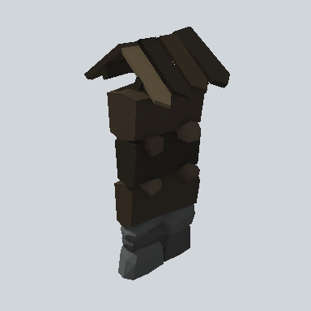

# EA03_Fence_Wall_01d_PRE

Generated by `tools/assets/gen_prefab_tables.py`: edit only below the Notes heading.

| Field | Value |
| --- | --- |
| Pack | EmaceArt-SlavicWorldFree |
| Path | `Prefabs/Fence/Wall/EA03_Fence_Wall_01d_PRE.prefab` |
| GUID | `162e4f25bf762e74eaa8fef8d72a02a9` |
| Subgroup | Wall |
| Size (m) | 3.5 |
| Collider | Mesh |
| LODs | 3 |
| Meshes | `EA03_Fence_Wall_01d.fbx` |
| Materials | `EA03_LPNP-Slavika_Colorsheet_v1.mat` |
| Nested prefabs | none |
| In demo scene | 0 |
| Bounds W x H x D (m) | 1.50 x 3.54 x 1.63 |
| Footprint (m) | 1.5 x 1.6 |
| Pivot | bottom at y = 0.00; center offset x 0.51, z -0.06 |
| Triangles / vertices (LOD0) | 612 / 1,318 |
| Average color | `#292520` |
| Dominant colors | `#211D18` 26%, `#2E2B29` 25%, `#28231C` 22% |

Colors are read from the rendered preview, so they include lighting. Bounds cover LOD0 renderers.

## Notes

TODO: hand-written usage notes.
