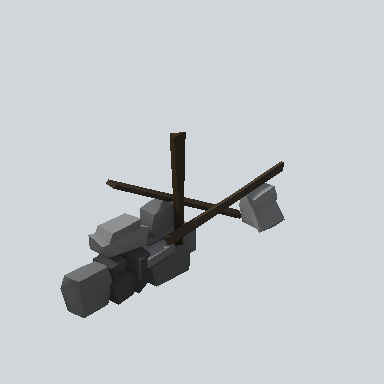

# EA03_Fence_rockDesk_01g_PRE

Generated by `tools/assets/gen_prefab_tables.py`: edit only below the Notes heading.

| Field | Value |
| --- | --- |
| Pack | EmaceArt-SlavicWorldFree |
| Path | `Prefabs/Fence/rockDesk/EA03_Fence_rockDesk_01g_PRE.prefab` |
| GUID | `91cecf15f3868ee46b6dcda0eae33237` |
| Subgroup | rockDesk |
| Size (m) | 4.1 |
| Collider | Mesh |
| LODs | 3 |
| Meshes | `EA03_Fence_rockDesk_01g.fbx` |
| Materials | `EA03_LPNP-Slavika_Colorsheet_v1.mat` |
| Nested prefabs | none |
| In demo scene | 0 |
| Bounds W x H x D (m) | 4.10 x 1.81 x 0.69 |
| Footprint (m) | 4.1 x 0.7 |
| Pivot | bottom at y = 0.00; center offset x -0.43, z 0.00 |
| Triangles / vertices (LOD0) | 249 / 447 |
| Average color | `#3D3C3B` |
| Dominant colors | `#303030` 37%, `#494A4B` 24%, `#211C16` 10% |

Colors are read from the rendered preview, so they include lighting. Bounds cover LOD0 renderers.

## Notes

TODO: hand-written usage notes.
