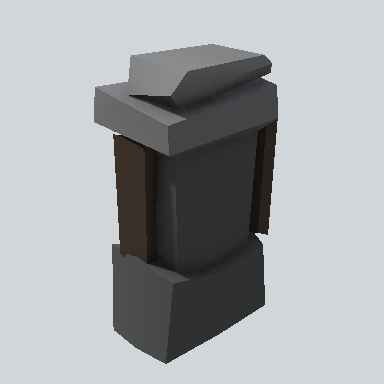

# EA03_Fence_rockDesk_End_01a_PRE

Generated by `tools/assets/gen_prefab_tables.py`: edit only below the Notes heading.

| Field | Value |
| --- | --- |
| Pack | EmaceArt-SlavicWorldFree |
| Path | `Prefabs/Fence/rockDesk/EA03_Fence_rockDesk_End_01a_PRE.prefab` |
| GUID | `4e10276c0d50e804e96c8e0c88e88ba5` |
| Subgroup | rockDesk |
| Size (m) | 1.2 |
| Collider | Mesh |
| LODs | 3 |
| Meshes | `EA03_Fence_rockDesk_End_01a.fbx` |
| Materials | `EA03_LPNP-Slavika_Colorsheet_v1.mat` |
| Nested prefabs | none |
| In demo scene | 0 |
| Bounds W x H x D (m) | 0.72 x 1.23 x 0.50 |
| Footprint (m) | 0.7 x 0.5 |
| Pivot | bottom at y = 0.00; center offset x -0.01, z -0.04 |
| Triangles / vertices (LOD0) | 114 / 209 |
| Average color | `#3E3E3D` |
| Dominant colors | `#2F2E2D` 52%, `#474849` 23%, `#868788` 8% |

Colors are read from the rendered preview, so they include lighting. Bounds cover LOD0 renderers.

## Notes

TODO: hand-written usage notes.
