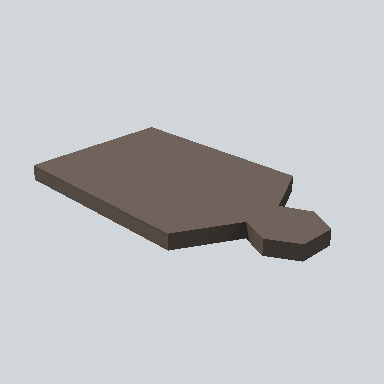

# EA03_Items_House_BredBoard_01a_PRE

Generated by `tools/assets/gen_prefab_tables.py`: edit only below the Notes heading.

| Field | Value |
| --- | --- |
| Pack | EmaceArt-SlavicWorldFree |
| Path | `Prefabs/Items/Crockery/EA03_Items_House_BredBoard_01a_PRE.prefab` |
| GUID | `dbe9353ac8cafe44c9705937e8c1c96a` |
| Subgroup | Crockery |
| Size (m) | 0.6 |
| Collider | Mesh |
| LODs | 3 |
| Meshes | `EA03_Items_House_BredBoard_01a.fbx` |
| Materials | `EA03_LPNP-Slavika_Colorsheet_v1.mat` |
| Nested prefabs | none |
| In demo scene | 0 |
| Bounds W x H x D (m) | 0.32 x 0.03 x 0.56 |
| Footprint (m) | 0.3 x 0.6 |
| Pivot | bottom at y = 0.00; center offset x 0.00, z -0.00 |
| Triangles / vertices (LOD0) | 37 / 67 |
| Average color | `#655A52` |
| Dominant colors | `#6E625A` 78%, `#35302C` 11%, `#514841` 10% |

Colors are read from the rendered preview, so they include lighting. Bounds cover LOD0 renderers.

## Notes

TODO: hand-written usage notes.
