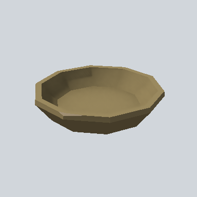

# EA_Items_House_bowl_wod_PRE

Generated by `tools/assets/gen_prefab_tables.py`: edit only below the Notes heading.

| Field | Value |
| --- | --- |
| Pack | EmaceArt-SlavicWorldFree |
| Path | `Prefabs/Items/Crockery/EA_Items_House_bowl_wod_PRE.prefab` |
| GUID | `5951f971024a62945a70df5f4c2985e1` |
| Subgroup | Crockery |
| Size (m) | 0.4 |
| Collider | Mesh |
| LODs | 3 |
| Meshes | `EA_Items_House_bowl_wod.fbx` |
| Materials | `EA03_LPNP-Slavika_Colorsheet_v1.mat` |
| Nested prefabs | none |
| In demo scene | 0 |
| Bounds W x H x D (m) | 0.38 x 0.08 x 0.40 |
| Footprint (m) | 0.4 x 0.4 |
| Pivot | bottom at y = -0.00; center offset x 0.00, z 0.00 |
| Triangles / vertices (LOD0) | 124 / 145 |
| Average color | `#756747` |
| Dominant colors | `#96855B` 35%, `#514832` 18%, `#453C29` 18% |

Colors are read from the rendered preview, so they include lighting. Bounds cover LOD0 renderers.

## Notes

TODO: hand-written usage notes.
