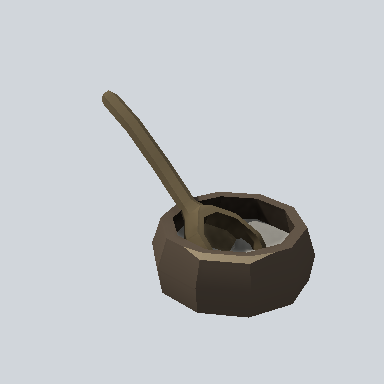

# EA_Items_House_bowl_wooden_powder_02a_PRE

Generated by `tools/assets/gen_prefab_tables.py`: edit only below the Notes heading.

| Field | Value |
| --- | --- |
| Pack | EmaceArt-SlavicWorldFree |
| Path | `Prefabs/Items/Crockery/EA_Items_House_bowl_wooden_powder_02a_PRE.prefab` |
| GUID | `3f6657538fc1b5b40a92930900607b01` |
| Subgroup | Crockery |
| Size (m) | 0.2 |
| Collider | Mesh |
| LODs | none |
| Meshes | `EA_Items_House_bowl_wod_powder_01a.fbx`, `EA_Items_House_spoon_wooden_02.fbx` |
| Materials | `EA03_LPNP-Slavika_Colorsheet_v1.mat` |
| Nested prefabs | `EA_Items_House_spoon_wooden_02_PRE` |
| In demo scene | 1 |
| Bounds W x H x D (m) | 0.23 x 0.25 x 0.41 |
| Footprint (m) | 0.2 x 0.4 |
| Pivot | bottom at y = -0.01; center offset x 0.00, z -0.08 |
| Triangles / vertices (LOD0) | 338 / 406 |
| Average color | `#473E33` |
| Dominant colors | `#342D27` 35%, `#645744` 16%, `#524838` 16% |

Colors are read from the rendered preview, so they include lighting. Bounds cover LOD0 renderers.

## Notes

TODO: hand-written usage notes.
