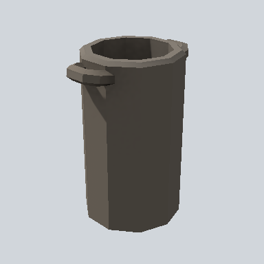

# EA_Items_House_cauldron_01a_PRE

Generated by `tools/assets/gen_prefab_tables.py`: edit only below the Notes heading.

| Field | Value |
| --- | --- |
| Pack | EmaceArt-SlavicWorldFree |
| Path | `Prefabs/Items/Crockery/EA_Items_House_cauldron_01a_PRE.prefab` |
| GUID | `77dd488734341a34f9117138d26bdc29` |
| Subgroup | Crockery |
| Size (m) | 0.5 |
| Collider | Mesh |
| LODs | 3 |
| Meshes | `EA_Items_House_cauldron_01a.fbx` |
| Materials | `EA03_LPNP-Slavika_Colorsheet_v1.mat` |
| Nested prefabs | none |
| In demo scene | 0 |
| Bounds W x H x D (m) | 0.39 x 0.48 x 0.28 |
| Footprint (m) | 0.4 x 0.3 |
| Pivot | bottom at y = 0.00; center offset x 0.00, z -0.00 |
| Triangles / vertices (LOD0) | 218 / 321 |
| Average color | `#4A453F` |
| Dominant colors | `#423D38` 63%, `#605950` 12%, `#34302B` 10% |

Colors are read from the rendered preview, so they include lighting. Bounds cover LOD0 renderers.

## Notes

TODO: hand-written usage notes.
