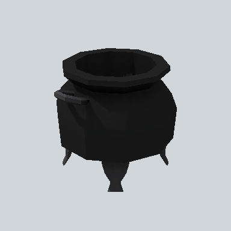

# EA_Items_House_cauldron_soup_01a_PRE

Generated by `tools/assets/gen_prefab_tables.py`: edit only below the Notes heading.

| Field | Value |
| --- | --- |
| Pack | EmaceArt-SlavicWorldFree |
| Path | `Prefabs/Items/Crockery/EA_Items_House_cauldron_soup_01a_PRE.prefab` |
| GUID | `f4b937c578a566a438aaa67e42a66e76` |
| Subgroup | Crockery |
| Size (m) | 0.5 |
| Collider | Mesh |
| LODs | 3 |
| Meshes | `EA_Items_House_cauldron_soup_01a.fbx` |
| Materials | `EA03_LPNP-Slavika_Colorsheet_v1.mat` |
| Nested prefabs | none |
| In demo scene | 0 |
| Bounds W x H x D (m) | 0.53 x 0.43 x 0.47 |
| Footprint (m) | 0.5 x 0.5 |
| Pivot | bottom at y = -0.00; center offset x 0.00, z 0.00 |
| Triangles / vertices (LOD0) | 718 / 1,135 |
| Average color | `#171718` |
| Dominant colors | `#151515` 83%, `#242425` 16%, `#1E1E20` 1% |

Colors are read from the rendered preview, so they include lighting. Bounds cover LOD0 renderers.

## Notes

TODO: hand-written usage notes.
