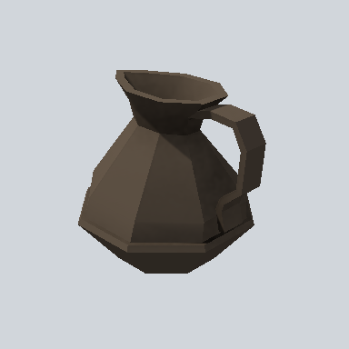

# EA_Items_House_kettle_01a_PRE

Generated by `tools/assets/gen_prefab_tables.py`: edit only below the Notes heading.

| Field | Value |
| --- | --- |
| Pack | EmaceArt-SlavicWorldFree |
| Path | `Prefabs/Items/Crockery/EA_Items_House_kettle_01a_PRE.prefab` |
| GUID | `60c864788d7efa2418bed99bbb835b3e` |
| Subgroup | Crockery |
| Size (m) | 0.3 |
| Collider | Mesh |
| LODs | 3 |
| Meshes | `EA_Items_House_kettle_01a.fbx` |
| Materials | `EA03_LPNP-Slavika_Colorsheet_v1.mat` |
| Nested prefabs | none |
| In demo scene | 0 |
| Bounds W x H x D (m) | 0.29 x 0.30 x 0.33 |
| Footprint (m) | 0.3 x 0.3 |
| Pivot | bottom at y = 0.00; center offset x 0.00, z -0.01 |
| Triangles / vertices (LOD0) | 292 / 447 |
| Average color | `#40372E` |
| Dominant colors | `#302A24` 35%, `#433A31` 22%, `#5A4E41` 15% |

Colors are read from the rendered preview, so they include lighting. Bounds cover LOD0 renderers.

## Notes

TODO: hand-written usage notes.
