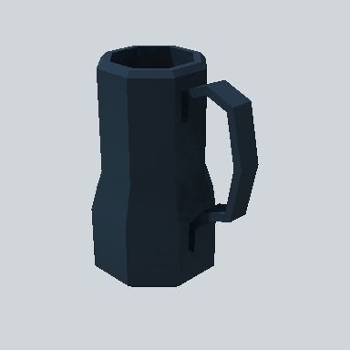

# EA_Items_House_mug_01b_PRE

Generated by `tools/assets/gen_prefab_tables.py`: edit only below the Notes heading.

| Field | Value |
| --- | --- |
| Pack | EmaceArt-SlavicWorldFree |
| Path | `Prefabs/Items/Crockery/EA_Items_House_mug_01b_PRE.prefab` |
| GUID | `7eb1907a1a1e7d4468f1cd2f206f8f6f` |
| Subgroup | Crockery |
| Size (m) | 0.3 |
| Collider | Mesh |
| LODs | 3 |
| Meshes | `EA_Items_House_mug_01b.fbx` |
| Materials | `EA03_LPNP-Slavika_Colorsheet_v1.mat` |
| Nested prefabs | none |
| In demo scene | 1 |
| Bounds W x H x D (m) | 0.17 x 0.31 x 0.25 |
| Footprint (m) | 0.2 x 0.3 |
| Pivot | bottom at y = 0.00; center offset x 0.00, z 0.01 |
| Triangles / vertices (LOD0) | 226 / 313 |
| Average color | `#1A252E` |
| Dominant colors | `#19232B` 50%, `#131B23` 15%, `#233442` 13% |

Colors are read from the rendered preview, so they include lighting. Bounds cover LOD0 renderers.

## Notes

TODO: hand-written usage notes.
